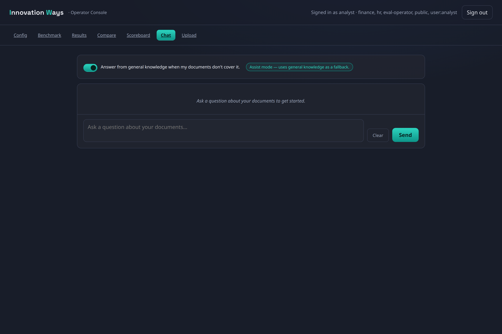
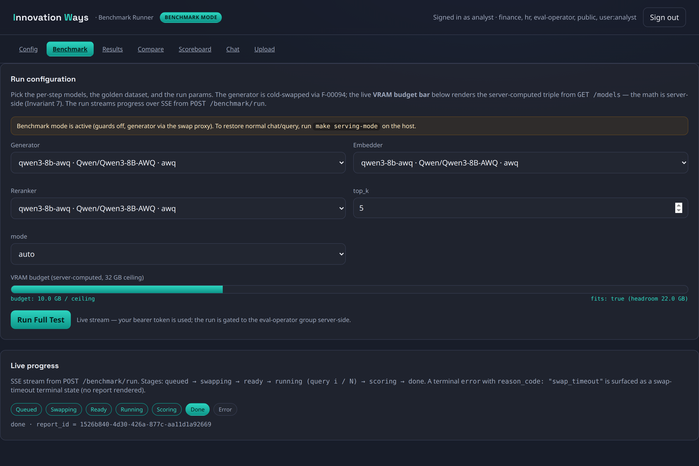
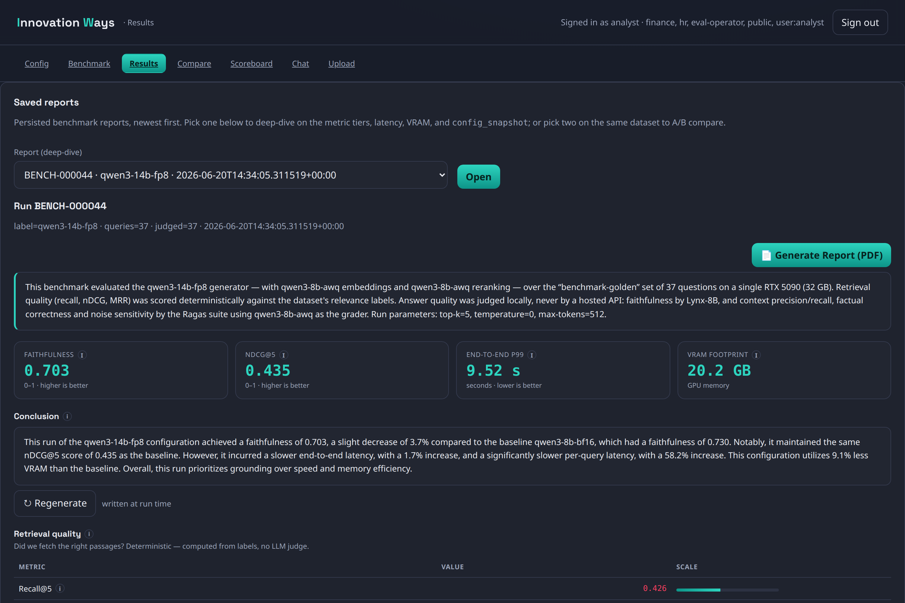
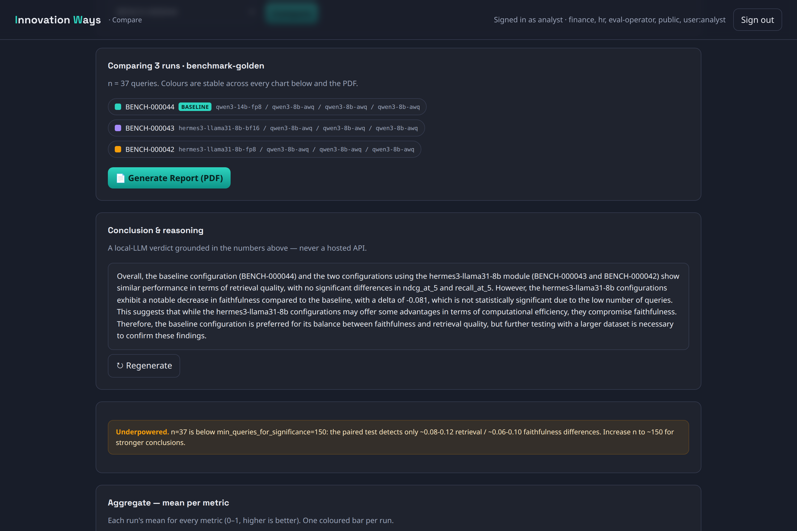
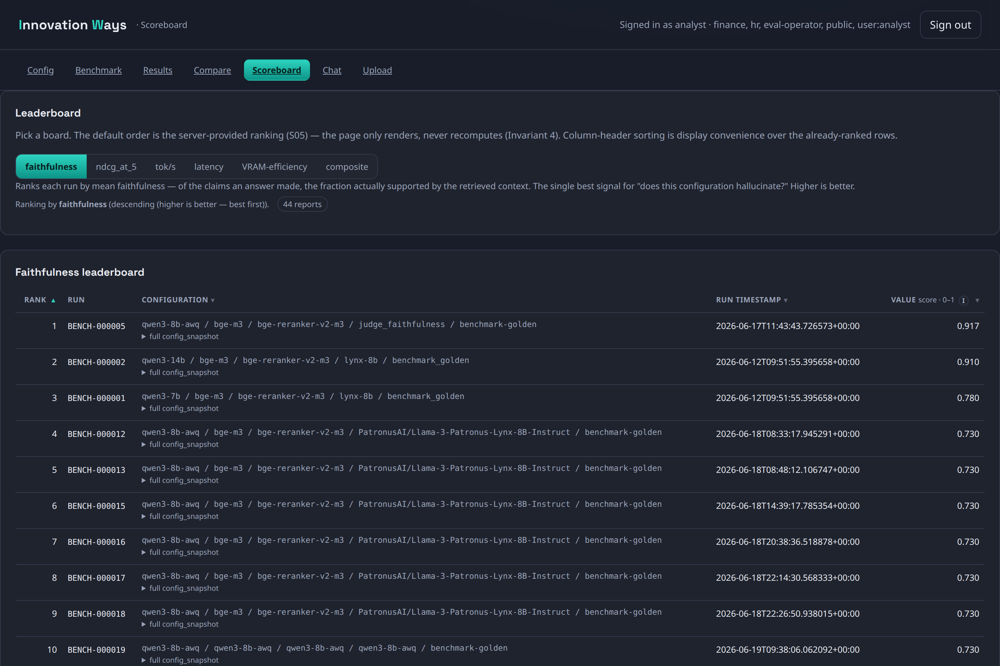
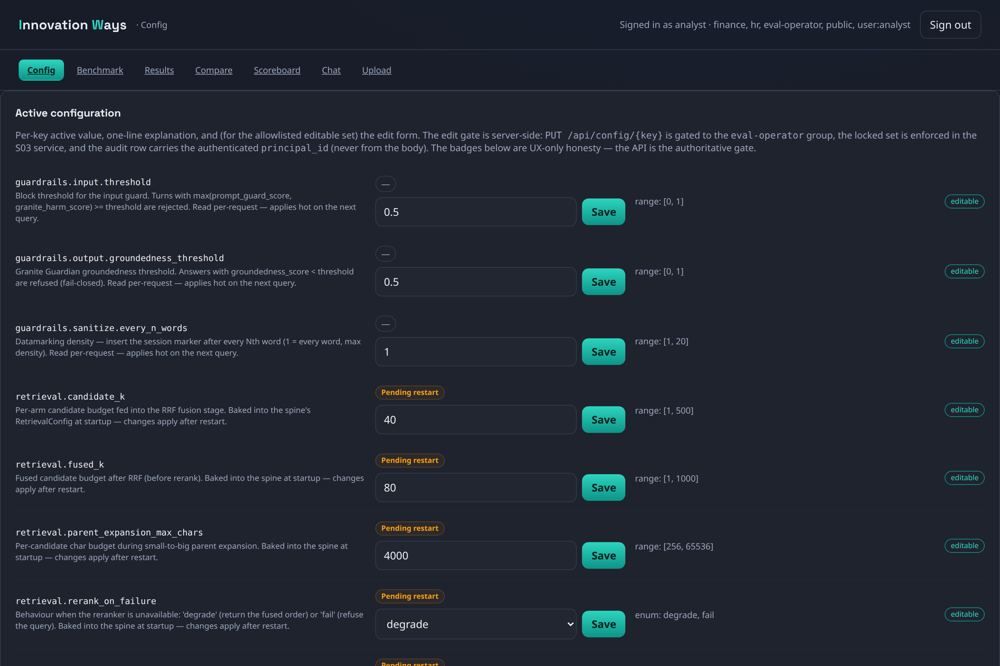

# iw-rag

**A fully-local, single-GPU, open-weight, agentic RAG system — with a measurement studio built in.**

iw-rag answers natural-language questions grounded in *your own documents* — with **inline citations** and **document-level access control** — running entirely on one machine. No data leaves the box: the generator, the embedder, the reranker, the guardrails, and even the LLM judges are all open-weight models served locally on a single GPU.

Its defining feature is a self-correcting **LangGraph retrieval loop** that grades its own work and **fails closed** rather than emit an answer it can't ground in a source. And because "trustworthy" is a claim you have to *prove*, iw-rag ships a first-class **Benchmark Studio** — an operator console for running, scoring, comparing, and ranking RAG configurations on quality *and* speed *and* VRAM, with statistical rigor. Capabilities here are **measured, not asserted**.

> It is the spiritual successor to the author's earlier "CORE" system.

---

## What you actually use: the Operator Console

Everything runs behind one server-rendered web console (htmx + vanilla JS, no SPA, no external CDN), served by the API itself and reachable at **`http://localhost:8088`**. One bearer-token sign-in gets you the full nav: **Config · Benchmark · Results · Compare · Scoreboard · Chat · Upload** (plus per-user **Documents** management).

### Ask grounded, cited questions

Ask a question about your documents; get back an answer with citations, the loop's trust verdicts, and — when nothing grounds the answer — an explicit **fail-closed** refusal instead of a hallucination. An optional "assist mode" toggle allows clearly-marked general-knowledge fallbacks.



You can **upload and manage your own documents** (txt / md / PDF + OCR) with per-user visibility (`specific` = owner-only vs `common` = shared), and **attach files to a single chat** as ephemeral, session-scoped, auto-purged context.

---

## The Benchmark Studio — "measured, not asserted", productized

This is where iw-rag's focus has matured: from *running* a RAG system to *proving* how well a given configuration performs. The Studio is an end-to-end measurement core wired into the console.

### Run a benchmark on the single GPU

Pick the per-step models (generator / embedder / reranker), `top_k`, and routed mode from the live catalog. A **server-computed VRAM budget bar** tells you whether the chosen stack fits the 32 GB ceiling *before* you run; the generator is cold-swapped in via the llama-swap controller (one resident model at a time). Progress streams live over SSE — `queued → swapping → ready → running → scoring → done` — and **survives navigation** (the run is a background task with a reconnectable event buffer).



### Read a full report

Every run is persisted **append-only** to `benchmark_reports` and rendered as a report: the three metric tiers (T1 deterministic retrieval, T2 judged faithfulness, T3 reference-required correctness), per-stage latency, VRAM footprint, model-load timing, and a **grounded narrative conclusion** written by a local judge LLM from the deterministic deltas (never a hosted API). Export any report to a branded **PDF**.



### Compare configurations, with statistics

A/B two runs or **multi-compare 2–5 runs** on the same dataset against a baseline. The Studio runs paired Wilcoxon / McNemar tests with BCa bootstrap CIs and Bonferroni-Holm correction, flags **underpowered** comparisons (`n < 150`), declares a winner only when *both* nDCG@5 *and* faithfulness agree, and writes a grounded verdict. Per-item heatmaps and answer/context diffs make the qualitative differences visible. Export the comparison to PDF.



### Rank everything on leaderboards

Six leaderboards rank the full append-only history: **faithfulness**, **nDCG@5**, **throughput (tok/s)**, **latency (p99)**, **VRAM efficiency (nDCG per GiB)**, and a normalized **composite**. The server computes the ranking; the page only displays it.



### Tune live

A guarded config editor lets an operator adjust guardrail thresholds, retrieval budgets, and rerank behavior — with per-key validation, range hints, and "pending restart" badges — so you can re-benchmark the effect of a change without editing files.



---

## Status

**Implemented and code-complete across phases 0–4**, validated **live** on an RTX 5090 (32 GB) for the retrieval spine, the agentic loop, and the guardrails (on a demo corpus). The eval harness, CI regression gate, and trust invariants are in place and green.

Since the initial code-complete milestone, several subsystems have landed and are live:

- **Operator Console** — one server-rendered htmx frontend for everything (Chat, Upload, Documents, and the whole Benchmark Studio); the standalone Chainlit UI has been **retired**.
- **Benchmark Studio** — model-swap infrastructure, the measurement core (T1/T2/T3 + latency + GPU/VRAM telemetry), append-only reports, A/B and N-way compare with statistical gating, six leaderboards, grounded LLM conclusions, sequential `BENCH-NNNNNN` ids, and PDF export.
- **Per-user document management** — upload / delete / list + ephemeral per-chat attachments, with PDF/OCR ingestion.
- **Single-GPU model-swap controller** — a llama-swap sidecar keeping exactly one resident generator on the 32 GB card, operator-gated; recent perf work moved generators to the `awq_marlin` kernel (~10× faster decode on Blackwell) and added an FP8/bf16 quantization ladder for cross-model sweeps.

Deferred and flagged as such: large-corpus benchmarks and a few heavy Phase-4 live runs (GraphRAG on an AGE-enabled Postgres, real ColVision visual encoding, deep red-team sweeps).

---

## The architecture in 30 seconds

- **Spine:** hybrid retrieval (BGE-M3 dense via pgvector + ParadeDB BM25) → RRF(k=60) → `bge-reranker-v2-m3` → top-k → small-to-big parent expansion, behind an **ACL pre-filter** (never a post-filter; groups come from auth, never the LLM).
- **Brain:** a LangGraph **Adaptive-RAG loop** — `input_guard → router → retrieve → sanitize → grade_documents → generate → grade_generation → output_guard → done / fail_closed → audit`, with bounded re-retrieval and a hard fail-closed.
- **Engine:** vLLM + an open-weight generator (Qwen3 family, AWQ-INT4 / FP8 variants) on a single **RTX 5090 (32 GB)** — dev = demo. Embeddings/reranker served by **infinity** on the same card.
- **Serving / model-swap:** a **llama-swap-backed swap controller** (`serving/` sidecar) keeps exactly **one resident generator** on the 32 GB card and swaps checkpoints on demand; operator-gated via `GET /models` + `POST /models/activate`. The model registry stays config-driven (`config/models.yaml` + `config/model_catalog.yaml`).
- **Documents:** **per-user document management** — upload (txt / md / PDF + OCR), delete, list, with `specific` (owner-only, `acl_tags:[user:<id>]`) vs `common` (`[public]`) visibility — plus **ephemeral per-chat attachments** (server-issued `session:<id>` tag, TTL-purged). Everything ingests into the same BGE-M3 space and is **ACL pre-filtered** exactly like the corpus.
- **Store:** one auditable **Postgres** (pgvector + ParadeDB `pg_search` BM25, + optional Apache AGE) — vectors, lexical, metadata, ACL, graph together.
- **Eval / Benchmark Studio:** an **offline measurement core** — T1 retrieval (recall@5/10, nDCG@5/10, MRR), T2 reference-free judged (faithfulness + κ, context precision), T3 reference-required (context recall, factual correctness), per-stage latency / VRAM / model-load timing, bootstrap 95% CIs — persisted **append-only** to `benchmark_reports` for statistically-gated **A/B and N-way model comparison**, leaderboards, grounded conclusions, and PDF reports.
- **Trust:** Phoenix tracing on the **OpenTelemetry GenAI conventions** + Ragas + local judges (Lynx-8B / Selene-Mini-8B, a *different model family* — no self-preference); a red-team probe suite and a CI regression gate back the guard + performance NFRs.
- **Guardrails (all local):** ACL pre-filter · prompt-injection classifier · datamarking/spotlighting · Granite Guardian groundedness · Presidio PII · grounded-citation validation · append-only audit.
- **Face & edge:** the **Operator Console** — a server-rendered htmx UI living inside the API (`src/iw_rag/api/console_*.py` + `*_page.py`) — behind a **Caddy** reverse proxy (Caddy routes `/` → `/console`). The whole stack is **Dockerized** (Compose; `dev` / `gpu` / `guards` / `benchmark` overlays).
- **Optional routed modes:** GraphRAG (AGE) · visual (ColVision late-interaction + caption fallback) · long-context — each behind the router, off by default, each returning the **same `RetrievalResult` contract** and falling back to the spine. **ACL caveat:** the spine and document-management paths enforce ACL as a *pre-filter*; the GraphRAG and visual modes currently apply ACL as a *post-filter* (per-edge / per-page pre-filtering is TBD), so they are restricted to **uniformly-readable corpora** until that lands. Long-context is a single sanctioned `acl_applied=false` carve-out, gated by an entry predicate that only admits non-ACL-scoped queries.
- **Out of scope (deliberate):** structured-data / NL-to-SQL — iw-rag is **document-RAG only** (HLD NG6). And **no hosted/cloud API anywhere**, including guards and judges.

## Quick start

```bash
# 1. Bring up the stack (Postgres, vLLM, infinity, Phoenix, API + Console, Caddy)
make up

# 2. Gating check — the VRAM co-residence spike the 32 GB design rests on
make spike            # and: GUARDS_ON=1 make spike

# 3. Ingest a corpus (the demo corpus ships under tests/fixtures/corpus)
make ingest CORPUS=tests/fixtures/corpus/manifest.yaml

# 4. Open the Operator Console and sign in
#    http://localhost:8088   (demo users: analyst/analyst, hr/hr)
#    - Chat: ask a grounded, cited question; toggle "assist mode" for general-knowledge fallback
#    - Upload / Documents: manage your own docs; attach files to a single chat via the paperclip
#    - Benchmark / Results / Compare / Scoreboard: the Benchmark Studio (eval-operator group)
#    - Config: live-tune guardrail/retrieval settings (eval-operator group)

# 5. Or hit the API directly. The bearer token resolves ACL groups server-side
#    (demo tokens: demo-finance → [finance, public]; demo-hr → [hr, public]).
TOKEN=demo-finance
curl -s -X POST http://localhost:8088/api/query \
  -H "Authorization: Bearer $TOKEN" -H "Content-Type: application/json" \
  -d '{"query":"What is the total amount due on the Q3 invoice?"}' | jq

# 6. Operator: list / swap the resident generator on the single GPU (eval-operator group)
curl -s http://localhost:8088/api/models -H "Authorization: Bearer $TOKEN" | jq   # catalog + active_model_id
```

### Serving vs benchmark mode

The single GPU does one job at a time. Two `make` targets flip the box between them:

```bash
make serving-mode     # normal chat/query, guards on  (default)
make benchmark-mode   # Benchmark Studio swap sidecars up, guards off
```

The console shows a **mode badge** so you always know which mode the box is in. (Normal Chat/Query is disabled while in benchmark mode — the generator is driven through the swap proxy.)

Full deployment, configuration, and API details: **[guide/09 · Operations](guide/09-operations.md)**.

## 📖 Documentation — the full guide

The committed, step-by-step system guide lives in **[`guide/`](guide/00-index.md)**:

| Chapter | |
|---|---|
| [01 · Overview](guide/01-overview.md) | what it is, the design principles, features, non-goals |
| [02 · Architecture](guide/02-architecture.md) | components, container topology, the query path, VRAM budget |
| [03 · Ingestion](guide/03-ingestion.md) | parse → chunk → enrich → embed → persist (offline) |
| [04 · Retrieval spine](guide/04-retrieval-spine.md) | ACL pre-filter → hybrid → RRF → rerank → expand |
| [05 · Agentic loop](guide/05-agentic-loop.md) | route → grade → retry → generate → grade → **fail closed** |
| [06 · Guardrails](guide/06-guardrails.md) | layered local guards: input, sanitize/datamark, output, audit |
| [07 · Optional modes](guide/07-optional-modes.md) | GraphRAG · visual · long-context (gated, measured) |
| [08 · Trust & evaluation](guide/08-trust-and-eval.md) | local judges, the headline experiments + numbers, Phoenix, κ |
| [09 · Operations](guide/09-operations.md) | deploy, configure, run, query, migrate, test, observe |

## Developing

```bash
make lint     # ruff check + format check
make type     # mypy --strict src
make test     # unit + integration (testcontainers Postgres)
make eval     # offline headline experiments (run_eval.py)
```

Tests and quality gates are also launchable per-project from the IW dashboard (with Allure reports), configured via `.iw-orch.json`.

## Repository layout

```
iw-rag/
├── src/iw_rag/        ← the application
│   ├── domain/        ← canonical types (models.py, acl.py, errors.py) — imports nothing
│   ├── ingestion/     ← offline: parse · chunk · enrich · embed · pipeline
│   ├── retrieval/     ← the spine: acl_filter · encode · dense · sparse · fusion · rerank · spine
│   ├── generation/    ← answer assembly, citations, fail-closed (llm clients)
│   ├── agent/         ← the LangGraph verification loop (graph.py, nodes.py, state.py, edges.py)
│   ├── guardrails/    ← input_guard · sanitize · output_guard · audit
│   ├── serving/       ← llama-swap model-swap controller + sidecar (one resident generator)
│   ├── modes/         ← optional GraphRAG / visual / long-context
│   ├── eval/          ← judges, experiments, metrics, calibration, CI gate · benchmark/ (Benchmark Studio core)
│   ├── observability/ ← OpenTelemetry/OpenInference tracing → Phoenix
│   ├── storage/       ← the ONLY layer that talks to Postgres
│   └── api/           ← FastAPI routes + the server-rendered Operator Console (console_*.py, *_page.py)
├── frontend/          ← RETIRED Chainlit UI (kept for reference, not deployed)
├── docker/            ← Compose stack + per-service Dockerfiles (+ benchmark/guards/gpu overlays)
├── config/            ← default.yaml + models.yaml / model_catalog.yaml (model registry; model-agnostic)
├── alembic/           ← schema migrations
├── eval/              ← golden set, calibration slice, experiment harnesses
├── scripts/           ← spike, ingest, run_eval / run_golden_eval / run_loop_eval / run_redteam_eval / run_kappa_eval
├── tests/             ← unit + integration (+ demo corpus fixtures)
├── guide/             ← 📖 the full system guide (start at guide/00-index.md) + assets/ (console screenshots)
└── Makefile           ← up · spike · ingest · eval · lint · type · test · serving-mode · benchmark-mode
```

> The detailed design + research package (HLD, LLDs, ADRs, task guides, conventions) lives under `docs/` locally; it is intentionally not committed to this repository. The `guide/` directory is the committed, reader-facing documentation.

## License & attribution

Built under [Innovation Ways](https://github.com/innovation-ways). The canonical package/import root is `iw_rag`.
