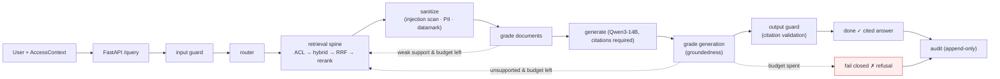

# iw-rag — the complete guide

A fully-local, single-GPU, open-weight **agentic RAG** system whose headline is
the **verification layer**: a self-correcting LangGraph loop that grades its own
retrieval and generation and **fails closed** rather than emit an ungrounded
answer. It answers questions grounded in your own documents — with **citations**
and **document-level access control** — without a byte leaving the box.

This guide explains the system end to end: what it is and why, how each layer
works, the technologies chosen and the reasoning, worked examples, and how to
operate it. Diagrams are Mermaid (they render on GitHub).

> **For the internal showcase**, start with the narrative [case study](../CASE-STUDY.md)
> — the story, the live experiment findings (incl. the honest negatives), the
> engineering war-stories, and a 5-minute demo script. This guide is the detailed
> reference behind it.

## Read in order

| # | Chapter | What it covers |
|---|---|---|
| 01 | [Overview](./01-overview.md) | What iw-rag is, the 7 design principles, features, non-goals, hardware target |
| 02 | [Architecture](./02-architecture.md) | Layered system, container topology, the query path, layering rules, VRAM budget |
| 03 | [Ingestion](./03-ingestion.md) | The offline pipeline: parse → chunk → enrich → embed → persist |
| 04 | [Retrieval spine](./04-retrieval-spine.md) | ACL pre-filter → hybrid (dense+BM25) → RRF → rerank → expand |
| 05 | [Agentic loop](./05-agentic-loop.md) | The LangGraph verification loop — route, grade, retry, **fail closed** |
| 06 | [Guardrails](./06-guardrails.md) | Layered local guards: input, sanitize/datamark, output, audit |
| 07 | [Optional modes](./07-optional-modes.md) | GraphRAG, visual, long-context — gated, measured, spine-fallback |
| 08 | [Trust & evaluation](./08-trust-and-eval.md) | Local judges, the headline experiments + numbers, Phoenix tracing, κ |
| 09 | [Operations](./09-operations.md) | Deploy, configure, run, query, migrate, test, observe |

## The system in one diagram

