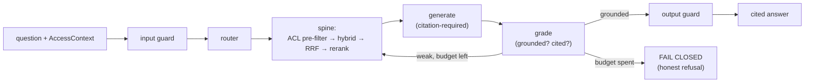

# iw-rag — overview

This is the front door to the iw-rag guide: what the system is, the principles
that shaped it, what it does, what it deliberately does **not** do, who it is for,
and where to go next.

`iw-rag` is a **fully-local, single-GPU, open-weight, agentic RAG system**. It
answers natural-language questions grounded in an organisation's own documents —
**with citations and document-level access control** — running entirely on one
machine, with **no byte leaving the box**. It is the spiritual successor to the
author's earlier "CORE" system.

Its defining feature is not the answer generator but the **verification layer**
around it: a self-correcting LangGraph loop that **grades its own retrieval and
generation** and **fails closed** — returning an honest "I can't ground an answer
in the retrieved evidence" — rather than emitting an ungrounded answer. "Looks
right" is treated as a liability, not a milestone; every capability is *measured*
on a golden set, not asserted.

That trust story is surfaced directly to the user. A thin **Chainlit** UI streams
the answer with inline numbered sources, shows the loop's route / grade verdicts /
retries / fail-closed decision, and links to the **Phoenix** trace for the run —
all behind a **Caddy** edge proxy, the whole stack in **Docker Compose**.

---

## 1. The seven design principles

Every decision in iw-rag traces back to one of these. The *why* matters as much
as the *what*.

1. **Local-only, open-weight, single-GPU.** No hosted API is called anywhere —
   not for generation, not for guards, not for judges or captioners. All weights
   are open and self-hostable. *Why:* the entire value proposition is that
   sensitive documents never leave the machine; it must be air-gap capable.
2. **Verification-first.** The trust layer (grounding checks, fail-closed, eval
   harness) is built in **Phase 1, before any capability mode**. *Why:* an
   ungrounded answer that looks right is worse than a refusal; trust is the
   differentiator, so it is engineered first, not bolted on.
3. **Measured, not asserted.** Every capability is justified by a repeatable
   experiment on a golden set. *Why:* a showcase's credibility comes from evidence
   (the eight headline experiments), not from claims.
4. **Assemble, don't adopt.** The system is built bespoke from libraries
   (LlamaIndex + LangGraph) rather than dropped onto a turnkey platform. *Why:* so
   the engineering judgment is visible and auditable, not hidden inside a black box.
5. **Model-agnostic.** Swapping any model is a `config/models.yaml` + env change,
   never a code change. *Why:* models churn fast; the architecture should outlive
   any single checkpoint.
6. **Two clocks.** Heavy work (parsing, embedding, graph extraction, captioning,
   LLM-judging, benchmarking) runs **offline / batch**; the **hot path** (retrieve →
   generate → guards) stays inside the resident-VRAM and latency budget. *Why:*
   this is what makes a single 32 GB GPU viable — offline jobs never contend with
   the resident generator.
7. **One auditable store.** Vectors, lexical index, metadata, ACL tags, and the
   graph all live in a single transactional **Postgres**. *Why:* a retrieval + ACL
   decision becomes one transaction with one audit trail — the compliance story is
   the differentiator.

---

## 2. What it does (features)

- **Grounded, cited answers.** Every claim cites a retrieved chunk ID; the
  generation prompt is citation-required.
- **Document-level access control as a pre-filter.** ACL is applied *before*
  vector search (`acl_tags && :principal_groups`), never as a post-filter that
  could leak existence or starve top-k. Entitlements come from the authenticated
  session — `AccessContext.principal_groups` — **never** from the LLM or user text.
- **Fail-closed refusal.** On weak retrieval or unsupported generation with the
  retry budget spent, the system refuses honestly rather than hallucinating.
- **Agentic self-correction loop.** A LangGraph Adaptive-RAG graph: route →
  retrieve → grade documents → (rewrite query & re-retrieve, bounded) → generate →
  grade generation → done or fail-closed. Loops are hard-bounded by an explicit
  retry counter and checkpointed.
- **Layered, fully-local guardrails.** ACL pre-filter · input guard (Prompt Guard
  2 + Granite Guardian) · context sanitization (datamarking + PII scrub) · output
  guard (groundedness + deterministic citation validation) · append-only audit log.
- **Hybrid retrieval.** BGE-M3 dense (pgvector HNSW) + BM25 (ParadeDB `pg_search`)
  → RRF(k=60) → `bge-reranker-v2-m3` cross-encoder → top-k. The result is the
  canonical `RetrievalResult.chunks: list[RetrievedChunk]` contract that the rest
  of the system consumes.
- **Phoenix tracing.** Every loop node is a span (OpenTelemetry GenAI conventions
  via OpenInference); retrieved chunks vs. answer grounding and per-step latency are
  inspectable.
- **Local judges + eval harness.** A golden set, judge-free retrieval metrics,
  local judges (Lynx-8B faithfulness, Selene-Mini-8B grading — a different model
  family from the generator to de-bias self-preference), Ragas scoring, and
  DeepEval CI regression gates.
- **Optional routed modes.** GraphRAG (AGE), visual (ColVision late-interaction),
  and a gated long-context route — each behind the router, each returning the same
  `RetrievalResult` contract, each measured before it is trusted. **ACL scope:** the
  spine and document-management paths are ACL **pre-filters**; GraphRAG and visual
  currently apply ACL as a **post-filter** (per-edge / per-page pre-filtering is TBD,
  so those modes are restricted to uniformly-readable corpora), and long-context is
  the single sanctioned `acl_applied=false` carve-out behind a non-ACL-scoped entry
  predicate.
- **Per-user document management.** Users upload (txt / md / PDF + OCR), list, and
  delete their **own** documents — `specific` visibility tags `acl_tags:[user:<id>]`
  (owner-only), `common` tags `[public]`. Plus **ephemeral per-chat attachments**:
  files scoped to one chat session via a server-issued `session:<id>` tag, re-validated
  on every query and TTL-purged when the chat ends. All of it ACL pre-filtered like the
  corpus; a dedicated document-manager page lives at `/documents/ui`.
- **Single-GPU model-swap.** A llama-swap-backed **swap controller** (a `serving/`
  sidecar) keeps exactly one resident generator on the 32 GB card and swaps checkpoints
  on demand, operator-gated via `GET /models` + `POST /models/activate` — so a
  benchmark can compare model A vs model B on the same card without a redeploy.
- **Benchmark Studio (measurement core).** An offline harness that runs a golden set
  through the live pipeline and persists one append-only `benchmark_reports` row per
  run: T1 retrieval (recall@5/10, nDCG@5/10, MRR), T2 reference-free judged
  (faithfulness + κ, context precision), T3 reference-required (context recall, factual
  correctness), per-stage latency / VRAM / model-load timing, and bootstrap 95% CIs —
  with statistically-gated A/B comparison of two reports.
- **Assist mode.** An opt-in "general knowledge" toggle: sends `allow_ungrounded=true`
  so the system may answer from parametric memory, **clearly marked** as such, with all
  guards still enforced.
- **Chainlit UI** surfacing sources, loop verdicts, fail-closed refusals, a
  "🔎 How grounded?" provenance panel, and a Phoenix trace link.
- **Docker Compose deploy.** One-command bring-up behind Caddy with GPU passthrough;
  `dev` and `demo` profiles.
- **Dashboard-launchable tests and quality runs** — `make ingest`, `make eval`,
  `make spike`, `make test`, `make lint`, `make type`.

---

## 3. Non-goals (what it is deliberately NOT)

- **Document-RAG only — no structured-data / NL-to-SQL / text-to-SQL.** Unlike its
  predecessor "CORE", iw-rag has **no SQL agent and no relational-data Q&A**. This
  is a conscious exclusion (HLD **NG6**), not an oversight. Tables *inside*
  documents are handled at the retrieval level (Docling/MinerU parsing); what is
  excluded is querying structured/relational sources via generated SQL.
- **No hosted / cloud API anywhere** — including guards, judges, and captioners.
  Nothing CC-BY-NC, research-only, or hosted-only is permitted.
- **Not a multi-GPU / cluster system.** Single GPU, single Postgres instance.
  Scale-out (a second GPU, Qdrant for visual, VectorChord for dense) is a documented
  *graduation trigger*, not a deliverable.
- **Not a production deployment.** This is a showcase: no committed SLA, HA, DR, or
  multi-tenancy. The honest "what production would take" gap analysis lives in the
  design's production-bridge appendix.

---

## 4. Who it's for + hardware target

**Audience.** Engineers and technical evaluators who need grounded answers over a
private document corpus *without* sending data to a cloud LLM — and who want to
*verify* the system isn't hallucinating. Two human roles:

- **End user / analyst** — asks questions, consumes cited answers (or honest
  refusals).
- **Operator** — ingests the corpus, runs eval, watches Phoenix traces.

**Hardware target.** One **NVIDIA RTX 5090, 32 GB GDDR7 (Blackwell, sm_120,
FP8-capable)** — used for **both dev and demo** (there is no separate demo card).
The hot path (BGE-M3 embedder + reranker + Qwen3-14B AWQ-INT4 generator with FP8
KV cache) co-resides on the one card, with a quantized Granite Guardian guard
fitting alongside when guards are on. Heavy offline jobs (judges, the VLM
captioner, graph extraction) run on the same card at batch time, never in the hot
path. Concurrency is VRAM/KV-bound at roughly 2–5 simultaneous users.

> **VRAM spike — PASS.** The gating Task 0.0 co-residence spike was run on the
> target card and **measured 23.9 GB peak resident** (generator + embedder +
> reranker), leaving ~8 GB / 25% headroom on the 32 GB card. Two Blackwell-specific
> findings shaped the setup: the generator runs on vLLM with `TRITON_ATTN` +
> FlashInfer (FlashAttention-3 is broken on Blackwell), and the embedder/reranker
> server is **`infinity`** rather than TEI (TEI ships no sm_120 build).

---

## 5. Status — what is built, what is honest

iw-rag is **code-complete across phases 0–4**: the retrieval spine, the agentic
loop, the layered guardrails, the optional modes, the eval harness, the Chainlit
UI, and the Docker Compose stack all exist in `src/iw_rag/` and `frontend/`.

Three subsystems landed **after** the phase 0–4 milestone and are also built:
**per-user document management** (upload/delete/list + ephemeral chat attachments,
with PDF/OCR), a **single-GPU model-swap controller** (`serving/`, llama-swap), and
the **Benchmark Studio measurement core** (`eval/benchmark/`, `benchmark_reports`).
The Benchmark Studio **run-UI** and **clickable source-download** on citations are
designed and in flight, not yet merged.

Be clear-eyed about validation depth:

- The **spine, agentic loop, and guards are validated live** on a *tiny demo
  corpus* (public technical docs + synthetic HR policies + dummy invoices) —
  enough to exercise free text, tables, exact-match identifiers, and multi-group
  ACL.
- The **VRAM co-residence spike passed** on the actual RTX 5090 (see §4).
- **All eight headline experiments have now been run live (demo-scale, 2026-06-08)** —
  including the three Phase-4 modes (#6 GraphRAG on AGE-for-PG18, #7 visual/ColVision,
  #8 native-32K long-context); see [ch08](./08-trust-and-eval.md). **Large-corpus
  benchmarks, latency targets, and the full concurrency cliff remain deferred** —
  measured-as-you-go, not pre-committed. Where a figure is a documentation-derived
  estimate rather than a measurement, the design says so.

> The repository [`README.md`](../README.md) reflects the built system (updated
> 2026-06-10) — including the document-management, model-swap, and Benchmark Studio
> subsystems noted above. This guide and the README are kept in sync.

---

## 6. How to read this guide

Each chapter is a focused deep-dive. Read them in order for a full tour, or jump
to the layer you care about.

| Chapter | Covers |
|---|---|
| [02 — Architecture](./02-architecture.md) | The layered system, C4 views, the request→answer path, VRAM layout, the cross-cutting contracts (`RetrievalResult`, `AccessContext`, `Settings`) |
| [03 — Ingestion](./03-ingestion.md) | Offline pipeline: Docling/MinerU parse → HybridChunker → ACL/metadata enrichment → Late-Chunking embed → Postgres upsert |
| [04 — Retrieval spine](./04-retrieval-spine.md) | ACL pre-filter → hybrid (dense + BM25) → RRF(60) → rerank → top-k; the one callable everything wraps |
| [05 — Agentic loop](./05-agentic-loop.md) | The LangGraph Adaptive-RAG state machine: router, grade-documents, grade-generation, bounded retries, fail-closed, checkpointing |
| [06 — Guardrails](./06-guardrails.md) | The five layers: ACL pre-filter, input guard, context sanitization (datamarking + PII), output guard, audit log |
| [07 — Optional modes](./07-optional-modes.md) | The routed Phase-4 modes — GraphRAG, visual, long-context — and the shared `RetrievalResult` contract |
| [08 — Trust & eval](./08-trust-and-eval.md) | Phoenix tracing, the golden set, local judges, Ragas, DeepEval CI gates, and the eight headline experiments |
| [09 — Operations](./09-operations.md) | Docker Compose bring-up, Caddy edge, GPU passthrough, the `make` targets, and day-to-day operator workflows |

For the authoritative design behind this guide, see
[`docs/build/`](../docs/build/README.md) — start with the
[architecture overview](../docs/build/00-architecture/architecture-overview.md)
and the [HLD](../docs/build/01-hld/hld.md). The canonical naming and contract rules
live in [`CONVENTIONS.md`](../docs/build/90-meta/CONVENTIONS.md).
