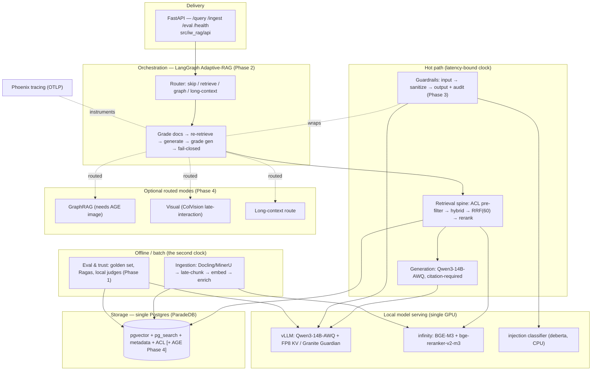
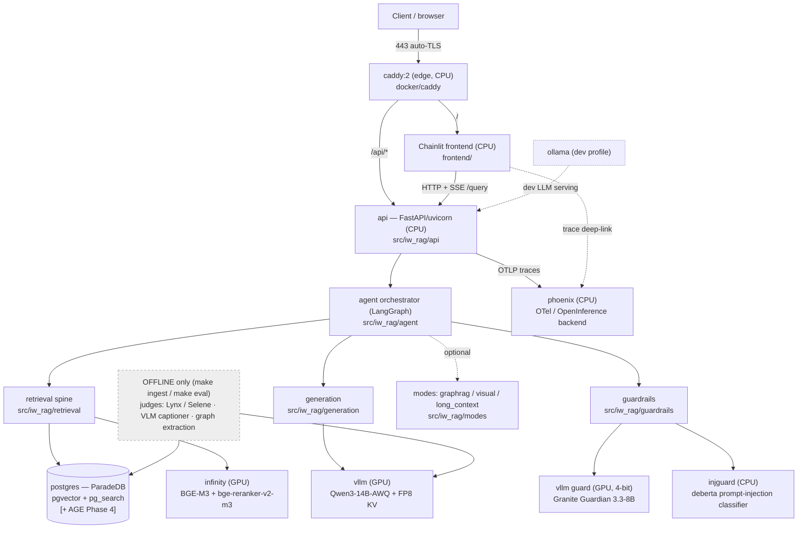
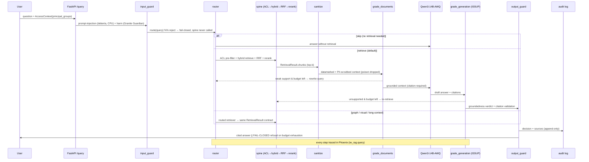
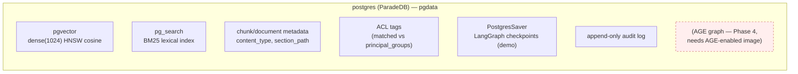
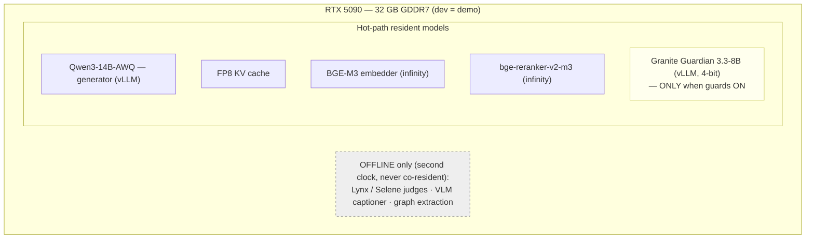

# Architecture

This is the keystone chapter: it ties every component of iw-rag together. If you
read only one chapter before touching the code, read this one — it shows the
layers, the running containers, the runtime query path, the package layout and
its layering rules, the single auditable store, and the VRAM budget that the
whole 32 GB design rests on.

iw-rag is a **fully-local, single-GPU, open-weight agentic RAG system**. It
answers natural-language questions grounded in an organisation's own documents —
with **citations** and **document-level access control** — entirely on one
machine, with no byte leaving the box. Its defining feature is not the answer
generator but the **verification layer** wrapped around it: a self-correcting
LangGraph loop that grades its own retrieval and generation and **fails closed**
rather than emit an ungrounded answer.

> **As-built note.** This chapter documents the system *as built and measured on
> the RTX 5090*, and where that differs from the design docs the difference is
> called out inline. The two corrections that recur: the embedding/reranker
> server is **infinity**, not TEI (TEI ships no Blackwell/`sm_120` build); and
> the running Postgres is the **ParadeDB** image carrying pgvector + `pg_search`
> only — Apache **AGE** (needed for GraphRAG) is *not* in the running image yet.

---

## 1. The layered architecture

The system is organised as a stack of layers where **dependencies point inward**.
The delivery shell (API) is the outermost ring; `domain/` (pure types) is the
innermost and depends on nothing. Two "clocks" run side by side: a latency-bound
**hot path** (retrieve → generate → guard) and an **offline/batch** clock for
heavy work (parsing, embedding, judging, captioning, graph extraction) that must
never contend with the generator for VRAM.



Reading the layers top-to-bottom:

- **Delivery** — `api/` is the only HTTP surface. Nothing inside depends on it.
- **Orchestration** — the LangGraph Adaptive-RAG loop routes the query and runs
  the grade → re-retrieve → generate → grade → fail-closed cycle.
- **Hot path** — the spine, the generator, and the (online subset of the)
  guardrails. Everything here lives inside the resident-VRAM and latency budget.
- **Optional modes** — GraphRAG, visual, and long-context, each behind the
  router and each returning the *same* `RetrievalResult` contract the spine does,
  so the generator and eval stay mode-agnostic.
- **Offline / batch** — ingestion and eval. Heavy, GPU-touching, run on demand
  via `make`, never resident.
- **Storage** — one Postgres holding vectors + lexical + metadata + ACL (+ graph).
- **Serving** — the local model servers (next section). A model-swap controller
  (`serving/`, llama-swap) optionally keeps one resident generator and cold-swaps
  it for benchmarking.

> **Post-milestone subsystems** (landed after phases 0–4; same layering, same
> contracts):
> - **Document management** — `api/documents_routes.py` lets a user ingest their
>   **own** documents on the *fast* clock (online light-parser → HybridChunker →
>   BGE-M3 embed → persist) with `owner_id` / `visibility` ACL, plus **ephemeral
>   per-chat attachments** (`session:<id>` tag, TTL). Retrieved and **ACL
>   pre-filtered** exactly like the corpus.
> - **Model-swap serving** — `serving/` + the `compose.benchmark.yaml` overlay
>   (`llama-swap` proxy + `swap-controller` sidecar) cold-swap the resident
>   generator behind operator-only `/api/models` + `/api/models/activate`.
> - **Benchmark Studio** — `eval/benchmark/` measurement core: runs a golden set
>   through the live pipeline and persists one append-only `benchmark_reports`
>   row (T1/T2/T3 quality + latency/VRAM + bootstrap CIs) for A/B model
>   comparison. Offline/batch — the slow clock.

---

## 2. Container topology (C4 — containers)

Everything ships as **Docker Compose**. A single **Caddy** edge fronts two CPU
services — the **Chainlit** frontend and the **FastAPI** API — and routes by
path. The API embeds the agent, spine, generation, and guardrails as in-process
Python; the GPU model servers and Postgres are separate containers.



**As-built corrections vs the design docs (important):**

| Design doc says | As built (and why) |
|---|---|
| Embeddings/reranker on **TEI** | **infinity** (`michaelf34/infinity`). TEI has no `sm_120`/Blackwell build; infinity's CUDA 12.9 base carries `sm_120`-capable torch (Task-0.0 finding, 2026-06-06). It serves **BGE-M3** + **bge-reranker-v2-m3** on the GPU. |
| Generator | **vLLM** `v0.11.0` (cu128) serving **Qwen3-14B-AWQ** with **FP8 KV cache**. |
| Guards = Prompt Guard 2 + Granite Guardian + Presidio | Safety guard = **Granite Guardian 3.3-8B** served on **vLLM, 4-bit**, co-resident. Injection guard = a **deberta** classifier (`protectai/deberta-v3-base-prompt-injection-v2`) on a **CPU** `/classify` server (no VRAM) — substituted for the *gated* Prompt Guard 2; model-agnostic, so a config swap. Presidio runs in-process (CPU). |
| Judges (Lynx / Selene) | **offline-only** — they run under `make eval`, on the second clock, and **never co-reside** with the generator. |
| Phoenix | Receives **OTLP** traces (OTel/OpenInference). An optional `otel-collector` (PII redaction + backend-swap) sits in front when the `obs` profile is enabled. |
| Postgres = pgvector + pg_search + **AGE** | Running image is **ParadeDB** = pgvector + `pg_search` (BM25). **AGE is NOT in the running image** — GraphRAG (Phase 4) needs an AGE-enabled image (`init/` build step or sibling extension image). |

**Compose layout.** `docker/compose.yaml` is the base (postgres, vllm, infinity,
phoenix, api, frontend, caddy). `docker/compose.gpu.yaml` overlays GPU
reservations for `vllm`/`infinity` (the `demo` profile). `docker/compose.dev.yaml`
adds **Ollama** + hot-reload (the `dev` profile). `docker/compose.guards.yaml` is
a local-only override that turns guardrails ON and wires the live guard endpoints
(`injguard` CPU classifier on `:8003`, Granite Guardian vLLM on `:8004`).
`docker/compose.benchmark.yaml` adds the **`llama-swap`** proxy (`:8080`,
internal) + the **`swap-controller`** sidecar (`:8090`, internal) for single-GPU
generator cold-swaps (Benchmark Studio). The base stack also carries an
`uploads` volume for document-manager staged bytes.

**Profiles.** `dev` = Ollama serving + `InMemorySaver` checkpointer + bind-mount
reload; `demo` = vLLM/infinity on the GPU + `PostgresSaver` (durable, same
Postgres). The `api`/`frontend`/`caddy`/`postgres`/`phoenix` services are
identical across profiles — only the model-serving backend, checkpointer, and
reload mounts swap, which keeps "dev = demo" honest at the topology level.

**Edge.** Caddy exposes a single origin (auto-TLS): `/api/*` → `api:8000` (prefix
stripped), everything else → `frontend:8000`. One origin means CORS stays trivial
and SSE/WebSocket pass through unbuffered for live token streaming.

**Volumes.** `pgdata` (the one store), `hf-cache` (shared model-weight cache —
download open weights once), `phoenix` (traces), `caddy-data` (TLS state).

---

## 3. The end-to-end runtime query path (the Adaptive-RAG loop)

A `/query` request carries a question plus an authenticated `AccessContext`
(whose `principal_groups` come **from auth, never from the LLM or the user**). The
loop routes the query, retrieves under an ACL pre-filter, grades the evidence,
generates a citation-required answer, grades the answer, and either returns it or
**fails closed** when the retry/recursion budget is spent.



Two seams worth calling out, because they are load-bearing in the code:

- **One groundedness authority.** `output_guard` does **not** re-call a
  groundedness model on the hot path. It *consumes* `state["gen_verdict"]` — the
  loop's single ISSUP outcome — and adds only deterministic citation validation +
  PII redaction. An invalid citation is a hard, deterministic block. This avoids
  a double model call and keeps the "one authority" property testable.
- **Fail-closed is the default outcome under uncertainty.** Weak document support
  with no budget left, an unsupported generation with no budget left, an input
  guard rejection, or an all-poisoned context — each routes to `fail_closed`,
  which refuses rather than guesses. Proven live: an HR analyst asking a finance
  question gets a refusal (the ACL pre-filter excludes finance; zero leak), and
  guards-on with guard models absent refuses rather than answering unguarded.

The full state machine, retry/recursion budgets, and node-by-node behaviour are
in [05 — The agentic loop](./05-agentic-loop.md).

---

## 4. Package layout and the layering rules

All application code lives under [`src/iw_rag/`](../src/iw_rag/). Directories map
to responsibilities:

| Package | Clock | Responsibility |
|---|---|---|
| [`domain/`](../src/iw_rag/domain/) | — | Pure types: `RetrievedChunk`, `RetrievalResult`, `Citation`, `GeneratedAnswer`, `GuardVerdict` (`models.py`); `AccessContext` + ACL tags (`acl.py`); typed exceptions (`errors.py`). **Imports nothing framework-specific.** |
| [`storage/`](../src/iw_rag/storage/) | both | The **only** layer that talks to Postgres: engine/session (`db.py`), table defs (`schema.py`), repositories (`repositories.py`), migration helpers. |
| [`ingestion/`](../src/iw_rag/ingestion/) | offline | Parse (Docling/MinerU) → chunk (parent→child) → enrich (ACL/metadata) → embed (BGE-M3 late-chunking) → `pipeline.py`. |
| [`retrieval/`](../src/iw_rag/retrieval/) | hot | The **spine**: `acl_filter.py`, `encode.py`, `dense.py` (pgvector), `sparse.py` (pg_search BM25), `fusion.py` (RRF k=60), `rerank.py`, assembled in `spine.py`. |
| [`generation/`](../src/iw_rag/generation/) | hot | `llm.py` (vLLM OpenAI-compatible client), citation-required `prompts.py`, `answer.py` (answer + citation assembly). |
| [`agent/`](../src/iw_rag/agent/) | hot | LangGraph: `state.py`, `nodes.py`, `edges.py`, `tools.py` (spine-as-tool), `checkpoint.py`, `graph.py`, `budgets.py`, router/grader `prompts.py`. |
| [`guardrails/`](../src/iw_rag/guardrails/) | hot (subset) | `input_guard.py`, `sanitize.py` (datamark + Presidio), `output_guard.py`, `acl.py`, append-only `audit.py`. |
| [`modes/`](../src/iw_rag/modes/) | offline index / hot query | `graphrag/`, `visual/`, `long_context/` — each returns the same `RetrievalResult`. |
| [`eval/`](../src/iw_rag/eval/) | offline | Golden set, judge-free retrieval metrics, judges (Lynx/Selene), Ragas runner, calibration, the 8 experiments, the CI gate. |
| [`observability/`](../src/iw_rag/observability/) | cross-cutting | `tracing.py` — Phoenix/OpenInference/OTLP setup. |
| [`api/`](../src/iw_rag/api/) | hot | Delivery shell: `app.py`, `routes.py`, `schemas.py`, `service.py`, `auth.py`. |

The layering rule is **dependencies point inward / downward**:

```
api → agent → {retrieval, generation, guardrails, modes} → storage → domain
                          ↘ ingestion (offline) ↗
eval / observability  → cross-cutting (may read any layer's public interface)
```

Concretely:

- **`domain/` imports nothing framework-specific.** Everything depends on it; it
  depends on nothing. The canonical contract is `RetrievalResult.chunks:
  list[RetrievedChunk]` (never `Candidate`/`.candidates`/`passages`), and access
  identity is `AccessContext.principal_groups`.
- **No layer imports `api/`.** The API is the outermost shell.
- **`storage/` is the only place that talks to Postgres.** Retrieval and
  ingestion go through repositories — the one encapsulated exception is the
  BM25/RRF SQL shim inside `retrieval/sparse.py` + `retrieval/fusion.py`.
- **LLM / embedding / judge access goes through typed clients** —
  `generation/llm.py`, `ingestion/embed.py` + `retrieval/encode.py`,
  `eval/judges.py` — never raw HTTP scattered around. Endpoints resolve from
  `config/models.yaml` via `settings.py`, so **swapping a model is a config
  change, never a code change** (which is exactly how TEI→infinity and Prompt
  Guard 2→deberta happened).
- **`modes/` plug into the agent via the same `RetrievalResult` contract** the
  spine returns — generator and eval stay mode-agnostic.
- **`frontend/` is a separate process and an API-only client** — it depends on
  nothing in `src/iw_rag/` and never touches Postgres, the model servers, or
  Phoenix directly; it reaches the system only through the FastAPI API over SSE.

**Configuration** is one typed `Settings` object (`settings.py`,
pydantic-settings), loaded once and injected. Nested keys map from env as
`IW_RAG__<SECTION>__<KEY>` (e.g. `IW_RAG__DB__DSN`,
`IW_RAG__GUARDRAILS__ENABLED`, `IW_RAG__MODELS__GUARD_SAFETY__ENDPOINT`).
Precedence is `config/default.yaml` < `.env` < process env; secrets via env only.

---

## 5. The single auditable store

There is **one Postgres** (the ParadeDB image) and it holds everything the system
needs to retrieve and to *prove* what it did:



Why one store: the audit story *is* the differentiator. Vectors, the lexical
index, metadata, ACL tags, the agent's durable checkpoints, and the audit log all
live in the same transactional database, so a retrieval and the decision that
followed it can be reconstructed together.

The **ACL is a pre-filter, never a post-filter**: the SQL predicate is
`acl_tags && principal_groups`, applied inside the retrieval query so excluded
documents never enter the candidate set or the ranker — they cannot leak through
a later truncation. `principal_groups` is populated from auth only.

**As-built caveat:** the running image carries pgvector + `pg_search`. The
**AGE** graph extension (the GraphRAG store) is *not* present yet; enabling Phase
4 GraphRAG requires an AGE-enabled Postgres image. See
[07 — Optional modes](./07-optional-modes.md).

---

## 6. VRAM budget (single 32 GB card)

The single RTX 5090 (32 GB, Blackwell) is the binding constraint, and it is why
the two-clocks rule exists. The hot-path co-residents — generator, embedder,
reranker, and (when on) the safety guard — must all fit in 32 GB at once; the
offline-clock models (judges, VLM captioner, graph extraction) run via `make` and
**never co-reside** with the generator.

These numbers are **measured live on the card during the build session**, not
estimates:



| Configuration | Resident models | Measured VRAM | Headroom |
|---|---|---|---|
| **Guards OFF** (hot path) | Qwen3-14B-AWQ + FP8 KV + BGE-M3 + bge-reranker | **≈ 23.9 GB** / 32 GB | ≈ 8.1 GB (25%) |
| **Guards ON** (Granite co-resident) | the four above **+** Granite Guardian (4-bit) | **≈ 31.4 GB** / 32 GB | ≈ 1.2 GB |

The injection classifier (deberta) runs on **CPU** and consumes no VRAM. Guards-on
fits because the 8.1 GB guards-off headroom comfortably exceeds the ~5–6 GB a
4-bit Granite Guardian needs — and the **31.4 GB** figure confirms it *live*
(previously this was inferred from the guards-off headroom). The gating spike
(`scripts/spike_vram.py`, `make spike` / `GUARDS_ON=1 make spike`) returned
`RESULT: PASS`, with hot-path latencies of embed ≈ 11.6 ms, rerank ≈ 10.8 ms,
generate TTFT ≈ 99 ms.

The one thing that will **not** co-reside on 32 GB is a *vision-native* (resident
VLM) generator for visual QA — that needs a swap or a second card. The Phase-4
visual mode handles this on the offline clock (captioning) instead. See
[07 — Optional modes](./07-optional-modes.md).

---

## 7. Component summary

Layer · component · choice · why — corrected to as-built (note **infinity** in
place of TEI, and AGE flagged as not-yet-resident).

| Layer | Component | Choice (as built) | Why |
|---|---|---|---|
| Edge / Deploy | Reverse proxy + orchestration | Caddy (auto-TLS) + Docker Compose | Single origin, trivial CORS, SSE pass-through; reproducible local stack (ADR-016). |
| Frontend | Chat UI | Chainlit (`frontend/`, API-only client, SSE) | Surfaces the trust story — streamed answer, sources, loop steps, Phoenix link (ADR-015). |
| Delivery | API | FastAPI / uvicorn (`api/`) | The only HTTP surface; `/query` `/ingest` `/eval` `/health`. |
| Orchestration | Agent loop | LangGraph Adaptive-RAG | Router + grade/re-retrieve/generate/grade/fail-closed, bounded + checkpointed (ADR-002/008). |
| Retrieval | Spine | hybrid (BGE-M3 dense + pg_search BM25) → RRF(60) → bge-reranker | Best local recall/precision without per-query LLM calls (ADR-003). |
| Embeddings/Rerank | Model server | **infinity** serving BGE-M3 + bge-reranker-v2-m3 (GPU) | **TEI has no `sm_120`/Blackwell build**; infinity's CUDA 12.9 base is `sm_120`-capable (Task-0.0 substitute, model-agnostic). |
| Embeddings | Model | BGE-M3 (dense 1024 + sparse, one model) | One model covers both arms (ADR-004). |
| Ingestion | Parse + chunk | Docling / MinerU + Late Chunking | Layout/table-aware parsing; no per-chunk LLM calls locally (ADR-005). |
| Generation | LLM serving | vLLM `v0.11.0` + Qwen3-14B-AWQ + FP8 KV | Fits 32 GB with headroom; AWQ + FP8 paths need `sm_120` kernels (ADR-006). |
| Storage | Vector + lexical DB | Postgres = **ParadeDB** (pgvector + pg_search); **AGE not yet resident** | One auditable store; AGE added later for GraphRAG (ADR-007). |
| Security | Guardrails | ACL pre-filter, datamarking + Presidio, **deberta** injection classifier (CPU), **Granite Guardian** (vLLM 4-bit) | Layered defense; injection guard substituted for gated Prompt Guard 2 (ADR-011). |
| Trust | Eval + obs | **Phoenix** (OTLP/OpenInference) + Ragas + Lynx-8B / Atla Selene-Mini-8B **(judges offline-only)** | Measured, not asserted; judges never co-reside with the generator (ADR-013/017). |
| Mode | GraphRAG | optional, offline index — **needs AGE-enabled image** | Relational / multi-hop questions (ADR-009). |
| Mode | Visual | ColVision late-interaction (optional; captioning offline) | Figure/table-heavy docs; resident VLM won't fit 32 GB (ADR-010). |
| Mode | Long-context | gated 4th route, native 32K | Small/static/whole-doc questions (ADR-012). |

For the rationale, alternatives, and consequences behind each row see the
[ADR set](../docs/build/00-architecture/adr/README.md); for NFRs and risks see
the [HLD](../docs/build/01-hld/hld.md).

---

## Related

- [03 — Ingestion](./03-ingestion.md): the offline clock — parse → chunk → embed →
  enrich → store, and how chunks get their ACL tags.
- [04 — The retrieval spine](./04-retrieval-spine.md): the hot-path core — ACL
  pre-filter → hybrid → RRF → rerank, returning `RetrievalResult.chunks`.
- [05 — The agentic loop](./05-agentic-loop.md): the LangGraph router, grade /
  re-retrieve / fail-closed state machine, budgets, and checkpointer.
- [06 — Guardrails](./06-guardrails.md): the input / sanitize / output / audit
  layers, the deberta + Granite Guardian guards, and the one-ISSUP-authority seam.
- [07 — Optional modes](./07-optional-modes.md): GraphRAG (needs AGE), visual, and
  long-context behind the router, each on the same `RetrievalResult` contract.
- [08 — Trust and eval](./08-trust-and-eval.md): Phoenix traces, the golden set,
  Ragas / judges (offline), and the CI regression gate.
