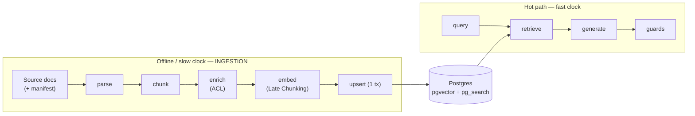
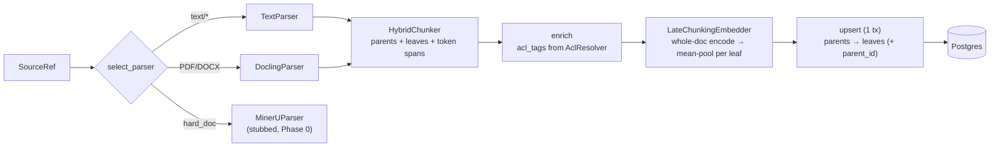

# Ingestion — from documents to retrievable chunks

Ingestion is how iw-rag turns a pile of source documents into the rows the
retrieval spine searches at query time. It runs **offline**, in batch, on the
**slow clock** — and it is the single place where the security-critical
**document-level ACL tags** are attached. Everything the system can later answer
(and everything it is *forbidden* to surface) is decided here.

This chapter walks the pipeline stage by stage, against the actual code in
`src/iw_rag/ingestion/`, and ends with a worked example: ingesting the demo
corpus via `make ingest`.

---

## 1. Where ingestion sits — the two clocks

iw-rag deliberately splits work across **two clocks**:

- **Hot path (fast clock):** `retrieve → generate → guards`. It must stay inside
  the resident-VRAM and latency budget. No heavy parsing, no per-document model
  loads, no batch work.
- **Offline / batch (slow clock):** parsing, chunking, embedding, graph
  extraction, captioning, LLM-judging, benchmarking. It may use heavy models and
  runs **when the generator is idle**.

**Ingestion is entirely on the slow clock.** It can afford to load a transformers
BGE-M3 model, run a whole-document forward pass per file, and write in
transactions — because nothing latency-sensitive is waiting on it. Its output is
the one auditable Postgres store (pgvector + ParadeDB) that the hot path reads.



The `ingestion/` package is **import-only** from `domain/`, `storage/` (via
repositories), `settings`, and the embed client. It never imports `api/`,
`agent/`, or `retrieval/` — dependencies point inward.

---

## 2. The pipeline stages

The pipeline is five stages run in order:

```
parse → chunk → enrich → embed → persist
```

Orchestrated by `IngestionPipeline.ingest_document` in
`src/iw_rag/ingestion/pipeline.py`. Crucially, **all transform stages run before
any database write**, so an embedding failure persists zero rows (atomicity —
see §3.4).



### 2.1 Parse — `parse.py`

**What it does:** reads a source file into an ordered list of layout-aware
`Block`s (`text | table | figure_caption | heading`) plus the concatenated
`full_text`. The output DTO is `ParsedDocument`.

**Key functions:** `select_parser(source, cfg)` routes; `Parser.parse` does the
work.

**Routing order** (`select_parser`, `src/iw_rag/ingestion/parse.py`):

1. explicit `force_parser` config override, else
2. `hints.hard_doc=True` → `MinerUParser`, else
3. `mime` in `{text/markdown, text/plain, text/x-markdown}` → `TextParser`, else
4. default → `DoclingParser`.

**Technology and why:**

- **Docling (MIT)** is the canonical default parser (ADR-005): layout-aware,
  air-gapped, LlamaIndex-native, and license-clean for a reusable showcase. It is
  lazy-imported (in the `ingest` dependency group) and exports the document to
  markdown, which is then split into blocks.
- **MinerU 2.5** is the *escalation* parser for hard docs (dense tables,
  formulas, multi-column, scanned, CJK). **Note (code vs design):**
  `MinerUParser` is **stubbed in Phase 0** — calling it always raises
  `ParseError`. The escalation path exists structurally but isn't implemented
  yet.
- **`TextParser`** is a code addition not in the original LLD: a dependency-free
  parser for born-digital markdown/plain text. Because the Phase-0 demo corpus is
  markdown, this lets ingestion run with **no heavy Docling dependency**. It
  splits markdown via `_split_markdown_blocks`: `#` headings become `heading`
  blocks and update the running `section_path` breadcrumb; `|`-delimited runs
  become `table` blocks; blank-line-separated runs become `text` blocks.

`SourceRef` carries `uri`, `mime`, `hints` (`ParseHints.hard_doc`), and an
optional filesystem `path`. Table/figure structured payload (markdown/HTML,
`bbox`, `image_ref`) is preserved on `Block.payload` for the future Phase-4
visual mode.

### 2.2 Chunk — `chunk.py`

**What it does:** turns the parsed blocks into a **parent→child tree** of
`ChunkNode`s, and emits the whole-document token stream the embedder needs.

**Key class:** `HybridChunker(cfg, tokenizer).chunk(doc) -> ChunkTree`.

**The small-to-big hierarchy** (ADR-005):

- **Leaves** are the embedded and searched unit (~256–512 tokens; default
  `leaf_tokens=384`). They reference their parent via `parent_local_id`.
- **Parents** are section-level merge units — the **synthesis-context return
  unit**. Retrieval matches on leaves but can expand leaf→parent at answer time.
  Ingestion only *persists* the hierarchy; the leaf→parent expansion itself is a
  retrieval/generation concern.

In the code, one parent is formed per `section_path`; the parent's `content` is
the joined text of its child leaves (`HybridChunker._build_parents`). Heading
blocks contribute their tokens to the document stream (as context) but produce no
leaf of their own.

**Why parent→child (and not semantic chunking):** ADR-005 found
parent-document retrieval is the highest-leverage chunking knob, while semantic
chunking repeatedly fails to justify its cost (recursive token splitting often
wins). So the design spends effort on the hierarchy, not on clever boundaries.

**Tokenizer-aware, and why it matters for Late Chunking:** the tokenizer is
**injected**, not hardcoded, and **must match the embedding model (BGE-M3)**.
`HybridChunker.chunk` tokenizes the document once into `ChunkTree.doc_token_ids`
and gives each leaf a `TokenSpan` (`[start, end)`) into that exact stream. This
guarantees the leaf spans index the *same* token sequence the embedder will run
its forward pass over — so mean-pooling per span is exact. Swapping embedders is
therefore a config change (new tokenizer), never a chunking-code change.

`ChunkTree` exposes `parents`, `leaves`, and `doc_token_ids` (plus a
`leaf_spans()` helper).

### 2.3 Enrich — `enrich.py`

**What it does:** attaches `acl_tags` — **and only ACL** — to every parent and
leaf node, from the `AclResolver`. Returns a new `ChunkTree`.

**Key function:** `enrich(tree, source, ctx) -> ChunkTree`.

`content_type`, `section_path`, and the parent linkage are already set by the
chunker; this stage layers ACL on top. The implementation is deliberately tiny:

```python
tags = list(ctx.acl_resolver.resolve(source))
parents = [replace(node, acl_tags=list(tags)) for node in tree.parents]
leaves  = [replace(node, acl_tags=list(tags)) for node in tree.leaves]
```

**Security invariant (the whole point of this stage):** `acl_tags` derive
**solely** from `ctx.acl_resolver.resolve(source)` — source-system metadata. **No
parsed text and no model output may ever influence them.** An empty resolver
result yields `acl_tags = []`, which makes the document **invisible to every
principal** (fail-closed; *never* world-readable). This is asserted by a
unit test. See §5 for why this must be a pre-filter downstream.

`IngestContext` carries the `AclResolver`, the `corpus_label`, and the
`ingestion_run_id`.

### 2.4 Embed — `embed.py` (Late Chunking)

**What it does:** produces one `ChunkEmbedding` per leaf — a normalized **1024-d
dense** vector — using **Late Chunking**.

**Key classes:** `LateChunkingEmbedder` (pure orchestration) wrapping a
`TokenEmbedder`; the default is `BgeM3TokenEmbedder`. Built via
`make_bge_m3_embedder(cfg)`.

**What Late Chunking is, and why:**

Naive chunk embedding embeds each leaf *in isolation*, losing document context.
**Contextual Retrieval** (Anthropic) recovers that context but costs **one LLM
generation per chunk** — locally that competes with the generator for the single
GPU at ingest time. **Late Chunking** gets most of the benefit with **one
embedding pass and zero LLM calls** (ADR-005): encode the *whole document* once
so every token attends to full-document context, then **mean-pool the per-token
vectors over each leaf's token span**. The prerequisite — an ≥8192-token-context
embedder — is already chosen, so Late Chunking is essentially free.

**Why BGE-M3 (MIT), 1024-d** (ADR-004):

- **One model feeds both spine arms.** BGE-M3 produces a dense vector *and* a
  learned-sparse vector from one forward pass — one model load (~1–2 GB fp16)
  instead of two. That minimizes VRAM contention with the reranker and generator.
- **8192-token context** imposes no chunk ceiling and is exactly what Late
  Chunking needs.
- **MIT license**, 100+ languages, first-class in LlamaIndex.
- Trade-off: it is below Qwen3-Embedding on *pure dense* quality and is **not**
  MRL-native — the schema fixes the dense dimension at **1024**, so a dimension
  squeeze means switching models (and re-indexing), not truncating.

**How it runs locally** (a code-level detail beyond the LLD): on Blackwell the
embedder is a **local BGE-M3 loaded via `transformers`** (the `ingest` dep
group), *not* the served TEI/infinity endpoint — because those endpoints expose
only a pooled vector, not the **token-level hidden states** Late Chunking needs
(open question Q-TEI). `BgeM3TokenEmbedder.embed_window` forwards a window of
token ids and returns the last-hidden-state row per token.

**Windowing for long documents:** `plan_windows(n_tokens, window, overlap)`
splits a >8192-token document into overlapping windows. `overlap_tokens` (default
512) **must be ≥ the max leaf size** so every leaf is fully contained in some
window. Each leaf is pooled from the **single window that fully contains it**
(`_window_for`), so **every leaf is embedded exactly once**. A leaf whose span no
window contains raises `EmbedError`.

**Sparse weights (code vs design):** `ChunkEmbedding.sparse_weights` is left
**empty (`{}`) in Phase 0**. The default production sparse arm is **ParadeDB
BM25** over `chunks.content`; BGE-M3 learned-sparse is a benchmark-gated
experiment. The schema keeps a `sparse_weights jsonb` column so that experiment
can run later without re-ingest, but the current pipeline does not populate it.

### 2.5 Persist — `pipeline.py`

**What it does:** maps the transient ingestion DTOs onto persisted rows and
writes them in **one transaction**.

**Key method:** `IngestionPipeline._persist_chunks`, called from
`ingest_document`.

Order of writes within the transaction:

1. **Idempotency check first:** `DocumentRepository.get_by_source_checksum(uri,
   checksum)`. If a row already exists for `(source_uri, checksum)`, return
   `IngestResult(status="skipped_unchanged")` — no work.
2. Run all transform stages (parse → chunk → enrich → embed) **with no DB
   writes**.
3. Open a session. If `supersede=true`, delete the prior document by URI (cascade
   drops its chunks). Upsert the `documents` row.
4. **Insert parents first** (to obtain their ids), build a `local_id → db id`
   map, then **insert leaves** referencing their parent via `parent_id`.
5. `session.commit()`.

A neat detail: each **parent's dense vector** is computed as the L2-normalized
mean of its children's leaf vectors (`_persist_chunks`), so parents are
searchable too, not just synthesis containers.

Per-document `ParseError`/`EmbedError`/`IngestionError` are **caught** and mapped
to `IngestResult(status="failed", error=…)` — one bad document never aborts the
corpus run, and never leaves partial rows.

---

## 3. Persistence & the data model

`pipeline.py` writes through `src/iw_rag/storage/repositories.py` into the schema
defined in `src/iw_rag/storage/schema.py`. The transient DTOs (`ParsedDocument`,
`ChunkNode`, `ChunkTree`, `ChunkEmbedding`) are **never persisted directly**.

### 3.1 `documents`

One row per `(source_uri, checksum)` — `UNIQUE (source_uri, checksum)`. Carries
`title`, `content_type` (default `'document'`), and links to the
`ingestion_run`. Written by `DocumentRepository.upsert_document`.

### 3.2 `chunks` (parents + leaves)

One row per node. Key columns (`schema.py`):

| Column | Type | Source |
|---|---|---|
| `document_id` | uuid FK | owning document |
| `parent_id` | uuid FK → `chunks.id`, `ON DELETE CASCADE` | leaf's parent (None for parents) |
| `ordinal` | int | position within parent/doc |
| `content` | text | node text (BM25 searches this) |
| `dense_embedding` | `vector(1024)` | Late-Chunking dense vector |
| `sparse_weights` | jsonb | empty in Phase 0 |
| `content_type` | text | `text | table | figure_caption` |
| `section_path` | text | heading breadcrumb |
| `acl_tags` | `text[]`, default `'{}'` | from `AclResolver` (§2.3) |
| `metadata` | jsonb | preserved `payload` (table/figure) |

Mapped via the `NewChunk` DTO and `ChunkRepository.bulk_upsert_chunks`.

### 3.3 `ingestion_runs`

One row per corpus run, created by `IngestionRunRepository.create` at the start
of `ingest_corpus` (status `running`) and moved to `succeeded`/`failed` by
`.finish()` at the end. Records `corpus_label`, `parser`, and `embed_model` for
audit.

### 3.4 Idempotency & atomicity

- **Idempotent on `(source_uri, checksum)`.** Re-ingesting an unchanged file is a
  no-op (`skipped_unchanged`). A changed file (new checksum) is, by default, a
  **new** document row — prior versions are retained unless `supersede=true`.
- **Atomic per document.** Because embedding completes *before* any write, an
  embed failure persists nothing; the parents + leaves are committed in one
  session, so a crash mid-write leaves no half-ingested document.

> **A note on `document_acl` (code vs design):** the schema also defines a
> `document_acl` table (`document_id, principal, permission`). The current
> ingestion pipeline does **not** write to it — ACL is **denormalized directly
> onto each chunk's `acl_tags`** so the retrieval pre-filter is a single
> array-overlap predicate with no join. `NewChunk.acl_tags` is documented as
> "denormalised from `DOCUMENT_ACL` at ingest," but in Phase 0 the source of
> truth is the resolver, written straight to `chunks.acl_tags`.

---

## 4. Worked example — ingesting the demo corpus

The demo corpus lives in `tests/fixtures/corpus/` and is **public + synthetic**
(no confidential data):

```
tests/fixtures/corpus/
├── manifest.yaml
├── public/intro.md          # acl_groups: [public]
├── hr/leave_policy.md        # acl_groups: [hr]   (has a markdown table)
└── finance/invoice_q3.md     # acl_groups: [finance] (has a line-items table)
```

### 4.1 The manifest is the ACL authority

`tests/fixtures/corpus/manifest.yaml` is the **source-system metadata** that
drives ACLs — exactly the thing the security invariant in §2.3 requires:

```yaml
documents:
  - uri: "corpus://public/intro.md"
    path: public/intro.md
    mime: text/markdown
    acl_groups: [public]
  - uri: "corpus://hr/leave_policy.md"
    path: hr/leave_policy.md
    mime: text/markdown
    acl_groups: [hr]
  - uri: "corpus://finance/invoice_q3.md"
    path: finance/invoice_q3.md
    mime: text/markdown
    acl_groups: [finance]
```

`acl_groups` here become the `acl_tags` on every chunk of that document. They are
declared by the operator, never inferred from the file's contents.

### 4.2 Running it

```bash
make ingest CORPUS=tests/fixtures/corpus/manifest.yaml
```

`make ingest` runs `uv run --group ingest python scripts/ingest_corpus.py
$(CORPUS)` (the `ingest` group pulls in `transformers`/`torch` for BGE-M3).
The script (`scripts/ingest_corpus.py`) wires the **real** pipeline — the same
`IngestionPipeline.ingest_corpus` the future `/ingest` API route calls:

1. `load_manifest` parses the YAML into typed `ManifestEntry` records.
2. `build_sources` turns each entry into a `SourceRef` (resolving `path` relative
   to the manifest directory, propagating `hard_doc`).
3. `ManifestAclResolver` indexes `uri → acl_groups` — this is the `AclResolver`
   implementation. `resolve` returns the manifest groups, or `[]` for an unknown
   URI (fail-closed).
4. A `BgeM3Tokenizer` and `make_bge_m3_embedder(...)` are built so the chunker
   and embedder share the **same** tokenizer. `leaf_tokens` and
   `embed_window_tokens` come from the typed `Settings` object
   (`settings.ingestion`).
5. `IngestionPipeline` is assembled with `select_parser` as the parser factory,
   then `ingest_corpus(sources, ctx)` runs with bounded concurrency
   (`settings.ingestion.concurrency`, default 2).

Each markdown file routes to `TextParser` (its mime is `text/markdown`), so no
Docling/MinerU download is needed for the demo. The HR and finance docs contain
markdown tables, which `_split_markdown_blocks` emits as `table` blocks
(preserved on `payload.markdown`).

The script prints one line per document and a run summary, e.g.:

```
  ingested           corpus://public/intro.md  (chunks=2)
  ingested           corpus://hr/leave_policy.md  (chunks=4)
  ingested           corpus://finance/invoice_q3.md  (chunks=3)
run 7c1e…: 3 docs, 0 failed
```

Re-running immediately yields `skipped_unchanged` for all three (idempotency).
The process exit code is non-zero if any document failed.

> Configuration is one typed `Settings` object; ingestion knobs map from
> `IW_RAG__INGESTION__*` env vars (e.g. `IW_RAG__INGESTION__LEAF_TOKENS=512`).
> Model names/endpoints come from `config/models.yaml` — never hardcoded.

---

## 5. ACL: attached here, enforced as a pre-filter later

Ingestion attaches **document-level group tags** to every chunk (§2.3). The
contract for *using* them at query time is fixed by CONVENTIONS:

- The caller's identity is `AccessContext.principal_groups`, which comes **from
  auth only — never from the LLM or user text**.
- A chunk's entitlements are `acl_tags: list[str]`.
- The enforcement predicate is the array overlap **`acl_tags && principal_groups`**.

**This must be a pre-filter, never a post-filter.** The overlap is applied
**inside the retrieval SQL**, so non-entitled chunks are never fetched, never
ranked, never seen by the reranker or the generator. A post-filter (retrieve
everything, then drop forbidden rows) would already have leaked content into the
model's context window and into telemetry — and a fusion/rerank step could surface
a forbidden chunk's text before the filter ever ran. Pre-filtering is the only way
to guarantee a principal cannot influence, or be exposed to, documents they may
not read.

The two halves work together: ingestion guarantees `acl_tags` are
**deterministic and source-derived** (an empty resolver → invisible, not
world-readable), and retrieval guarantees they are **applied before ranking**.
Get either half wrong and the access-control story collapses.

The retrieval spine returns its results as `RetrievalResult.chunks:
list[RetrievedChunk]` — already ACL-pre-filtered — which the agent and generator
consume. Ingestion's job is done once the entitled, embedded, parent-linked rows
are committed.

---

## Related

- [`./04-retrieval-spine.md`](./04-retrieval-spine.md) — how these chunks are
  searched, fused, reranked, and ACL-pre-filtered into
  `RetrievalResult.chunks: list[RetrievedChunk]`.
- [`./02-architecture.md`](./02-architecture.md) — the two-clocks principle, the
  single Postgres store, and where ingestion sits in the overall system.
