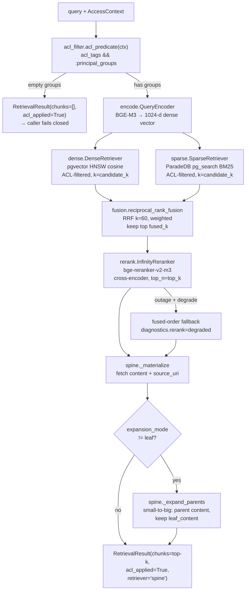

# The retrieval spine — ACL-filtered hybrid search

The **retrieval spine** is the load-bearing core of iw-rag: a single hot-path
callable that turns a natural-language query plus an authenticated identity into
a ranked, access-controlled, citable set of chunks. Everything else in the system
— the LangGraph agent loop, the generator, the guardrails, the eval harness, and
every Phase-4 retrieval mode — wraps or consumes this one callable. It is the
contract that keeps the rest of the system mode-agnostic.

This chapter explains what the spine is, the exact pipeline it runs, why each
stage exists, the security model behind the ACL pre-filter, the fusion algorithm,
a worked example over the demo corpus, and every operator-facing config knob.

Code lives in [`src/iw_rag/retrieval/`](../src/iw_rag/retrieval/):

| Module | Role |
|---|---|
| [`spine.py`](../src/iw_rag/retrieval/spine.py) | The assembled callable (`RetrievalSpine.retrieve`) — the LangGraph tool |
| [`acl_filter.py`](../src/iw_rag/retrieval/acl_filter.py) | `AccessContext` → SQL pre-filter predicate |
| [`encode.py`](../src/iw_rag/retrieval/encode.py) | Query embedding (BGE-M3 via the served endpoint) |
| [`dense.py`](../src/iw_rag/retrieval/dense.py) | Dense arm — pgvector HNSW cosine search |
| [`sparse.py`](../src/iw_rag/retrieval/sparse.py) | Sparse arm — ParadeDB `pg_search` BM25 |
| [`fusion.py`](../src/iw_rag/retrieval/fusion.py) | Reciprocal Rank Fusion (k=60), pure + unit-tested |
| [`rerank.py`](../src/iw_rag/retrieval/rerank.py) | Cross-encoder rerank — `bge-reranker-v2-m3` |

Design references: [LLD — Retrieval Spine](../docs/build/02-lld/lld-retrieval-spine.md),
[ADR-003 (hybrid + RRF + rerank)](../docs/build/00-architecture/adr/ADR-003-retrieval-spine-hybrid-rrf-rerank.md),
[ADR-007 (pgvector + ParadeDB)](../docs/build/00-architecture/adr/ADR-007-vector-store-pgvector-paradedb.md).

---

## 1. What the spine is — and its invariants

The spine is exposed as one method:

```python
async def retrieve(self, query: str, ctx: AccessContext) -> RetrievalResult: ...
```

It takes a query string and an `AccessContext` (the authenticated identity) and
returns a `RetrievalResult`. That return type is the **one cross-module
contract**: the same shape is produced by the Phase-0 spine *and* by every
optional Phase-4 mode (GraphRAG, visual, long-context), so the generator, the
agent, and the eval harness never branch on which retriever ran.

The canonical types (from [`domain/models.py`](../src/iw_rag/domain/models.py)):

```python
@dataclass(frozen=True, slots=True)
class RetrievedChunk:
    chunk_id: str
    content: str               # the matched leaf, OR the expanded parent
    score: float               # final ranking score (reranker, or fused fallback)
    source_uri: str            # where it came from — citations require this
    metadata: dict[str, Any]
    leaf_content: str | None   # the original leaf span, retained on parent expansion
    retriever: str
    acl_applied: bool

@dataclass(frozen=True, slots=True)
class RetrievalResult:
    chunks: list[RetrievedChunk]   # NEVER .candidates / .passages
    retriever: str                 # "spine" on the hot path
    acl_applied: bool
    query: str
    expansion_mode: str
    candidate_count: int           # fused candidates before rerank (observability)
    diagnostics: dict[str, Any]    # timings, arm sizes, degrade flags → Phoenix
```

> **Naming is canonical and mandatory.** The result list is
> `RetrievalResult.chunks: list[RetrievedChunk]` — never `Candidate`,
> `.candidates`, or `passages`. Access identity is
> `AccessContext.principal_groups`. See
> [CONVENTIONS.md §1–2](../docs/build/90-meta/CONVENTIONS.md).

### Invariants (test-asserted)

These hold on every hot-path result and are enforced in tests:

1. **`acl_applied is True`.** The spine always pre-filters and always sets this
   flag. (The *single* sanctioned `acl_applied=False` carve-out in the whole
   system is the long-context route, whose entry predicate admits only
   non-ACL, attribution-free, static whole-doc queries — see
   [CONVENTIONS.md §6](../docs/build/90-meta/CONVENTIONS.md). The spine itself
   never sets it `False`.)
2. **Sorted by `score`, best-first.** Reranker score is the primary ordering;
   if the reranker degrades, the fused-order fallback preserves descending order.
3. **`len(chunks) <= top_k`.** The reranker trims to `top_k`; the spine never
   returns more.
4. **Every `source_uri` is non-empty.** Citations require provenance —
   `get_retrievable` joins each chunk to its document's `source_uri`, so a chunk
   with no source never reaches the caller.

### Failure semantics

The spine distinguishes three failure shapes, and the distinction is deliberate:

| Condition | Behaviour | Code |
|---|---|---|
| **Reranker outage** | **Degrade**, do not fail. Falls back to fused (RRF) order for the top-k, sets `diagnostics["rerank"]="degraded"`. Configurable to `fail` via `rerank_on_failure`. | [`spine.py`](../src/iw_rag/retrieval/spine.py) (the `except RerankError` branch) |
| **Embedding outage** | **Hard error** (`RetrievalError`). The dense arm cannot run, so the agent treats it as a retrieval failure and fails closed upstream. | [`encode.py`](../src/iw_rag/retrieval/encode.py) |
| **Empty ACL set** (principal has no groups) | Return `RetrievalResult(chunks=[], acl_applied=True, diagnostics={"acl":"empty"})` immediately — a legitimate "nothing you can see matches". The caller (generator/agent) must **fail closed**: refuse rather than fabricate; never widen the ACL. | [`spine.py`](../src/iw_rag/retrieval/spine.py) + [`acl_filter.py`](../src/iw_rag/retrieval/acl_filter.py) `AclPredicate.is_empty` |

The asymmetry is the point: a missing reranker only *degrades precision*, so we
keep serving; a missing embedder *removes the semantic arm entirely*, so we stop.
An empty ACL set is not an error at all — it's a correct, secure answer that
happens to be empty.

---

## 2. The pipeline, stage by stage

The hot path runs:

> **ACL pre-filter → encode query → dense (pgvector) + sparse (BM25) arms →
> RRF fusion (k=60) → cross-encoder rerank → top-k → small-to-big parent
> expansion → `RetrievalResult`.**



### Stage 1 — ACL pre-filter

- **What:** Build a hard SQL predicate from the caller's groups before any
  search runs. `acl_predicate(ctx)` returns an `AclPredicate` whose
  `sql_clause()` is `acl_tags && :principal_groups` (Postgres array-overlap) and
  whose `params()` bind only `ctx.principal_groups`.
- **Module:** [`acl_filter.py`](../src/iw_rag/retrieval/acl_filter.py).
- **Why:** Security. Both retrieval arms carry this predicate, so a chunk the
  principal cannot see never enters either ranked list. See §3.

### Stage 2 — Encode the query

- **What:** Embed the query string into a 1024-d dense vector.
- **Module:** [`encode.py`](../src/iw_rag/retrieval/encode.py) —
  `InfinityQueryEncoder.encode` posts to the served `/embeddings` endpoint.
- **Technology and why:** **BGE-M3** (1024-d, multilingual, Apache-2.0). A
  *query* is a single short string, so a pooled embedding from the running
  embedder is exactly right — no token-level Late Chunking (that's an
  ingestion-only concern). Encoding failure is a hard `RetrievalError`.

  > **Implementation note / gap vs design.** The LLD sketches the query encoder
  > returning both a dense vector *and* learned-sparse weights. The shipped
  > `QueryEncoder.encode` returns only the dense `list[float]`. Consequently the
  > learned-sparse retriever arm (`sparse_arm="learned_sparse"`) is not wired in
  > the current spine — the sparse arm is **BM25 only**. This matches the
  > default config (`sparse_arm="bm25"`) and ADR-003's "BM25 as default sparse
  > arm"; learned-sparse remains a documented A/B experiment, not yet live.

### Stage 3a — Dense arm (semantic)

- **What:** Top-`candidate_k` nearest chunks by cosine distance, ACL-filtered.
- **Module:** [`dense.py`](../src/iw_rag/retrieval/dense.py) — `DenseRetriever.retrieve`.
- **Technology and why:** **pgvector** with an **HNSW** index over
  `chunks.dense_embedding`, ordered by `dense_embedding <=> :qvec` (cosine).
  Dense search captures *semantic* similarity — paraphrases, synonyms, concepts.
  Returns rank-ordered `RankedHit`s (rank, not raw score) so the scores never
  have to be compared across arms.

### Stage 3b — Sparse arm (lexical)

- **What:** Top-`candidate_k` chunks by BM25 relevance, ACL-filtered.
- **Module:** [`sparse.py`](../src/iw_rag/retrieval/sparse.py) — `SparseRetriever.retrieve`.
- **Technology and why:** **ParadeDB `pg_search`** real BM25 over
  `chunks.content`, via `id @@@ :bm25 ... ORDER BY paradedb.score(id) DESC`. This
  is the **sanctioned raw-SQL shim** (the one layering exception). The free-text
  query is sanitized to bare alphanumeric terms and turned into a
  `content:term1 OR content:term2 ...` pg_search query so the parser doesn't
  choke on punctuation in identifiers like `INV-2026-0931`.
  Why a custom shim and not LlamaIndex's built-in Postgres hybrid: that path uses
  Postgres `tsvector`/`ts_rank`, **not** true BM25. The data model commits to
  `pg_search` BM25 for genuine lexical scoring (ADR-007). **Why BM25 at all:**
  pure dense search quietly fails on exact-match anchors — IDs, SKUs, error
  codes, rare/OOV terms — which are exactly the queries an enterprise corpus is
  full of. The lexical arm is what catches `SKU-014` or `PO-44120` verbatim.

### Stage 4 — RRF fusion

- **What:** Merge the two ranked lists into one fused ranking, keep the top
  `fused_k`.
- **Module:** [`fusion.py`](../src/iw_rag/retrieval/fusion.py) —
  `reciprocal_rank_fusion`, a pure unit-tested function.
- **Technology and why:** **Reciprocal Rank Fusion, k=60** — combines by *rank*,
  not raw score, so dense cosine and BM25 scores never need to be normalized
  against each other. See §4.

### Stage 5 — Cross-encoder rerank

- **What:** Jointly re-score each `(query, chunk)` pair and keep the top
  `top_k`.
- **Module:** [`rerank.py`](../src/iw_rag/retrieval/rerank.py) —
  `InfinityReranker.rerank` posts to the served `/rerank` endpoint.
- **Technology and why:** **`bge-reranker-v2-m3`** (Apache-2.0, 568M params), a
  cross-encoder. Bi-encoder retrieval (dense/sparse) scores query and document
  *independently*; a cross-encoder reads them *together*, so it resolves
  fine-grained relevance the retrieval arms can only approximate. ADR-003 calls
  it "the single highest-ROI precision stage." On an outage it degrades to fused
  order (see §1).

  > **Serving note.** The design names **TEI** (HF Text-Embeddings-Inference) as
  > the canonical embedder/reranker server. TEI has no Blackwell (sm_120) build,
  > so on the target RTX 5090 the shipped code talks to **`infinity`**
  > (`InfinityReranker` / `InfinityQueryEncoder`, OpenAI-style `/embeddings` +
  > `/rerank`). This is a serving-engine swap only — the *models* and the
  > retrieval contract are unchanged ([CONVENTIONS.md §14](../docs/build/90-meta/CONVENTIONS.md)).

### Stage 6 — Materialize + small-to-big expansion

- **What:** Fetch full content + `source_uri` for the surviving ids, build
  `RetrievedChunk`s, then (unless `expansion_mode="leaf"`) replace each leaf's
  `content` with its **parent** chunk's content while keeping the matched leaf in
  `leaf_content`.
- **Module:** [`spine.py`](../src/iw_rag/retrieval/spine.py) — `_materialize`
  and `_expand_parents`, using
  [`ChunkRepository.get_retrievable`](../src/iw_rag/storage/repositories.py).
- **Technology and why:** **Small-to-big** retrieval. We *match* on small,
  precise leaf chunks (good for ranking precision) but *hand the generator* the
  larger parent (good for answer context). The citation still points at the
  matched leaf via `leaf_content`, so attribution stays precise even though the
  generator sees more surrounding text.

  > **Implementation note.** `ChunkRepository` exposes a dedicated `get_parents`,
  > but the shipped `_expand_parents` fetches parents via `get_retrievable` (the
  > same join that carries `source_uri`). Functionally equivalent for expansion;
  > the `get_parents` helper is currently unused by the spine.

### A note on concurrency

The LLD diagram shows the two arms running *in parallel*. The shipped spine runs
them **sequentially** on a single `AsyncSession` (a SQLAlchemy `AsyncSession` is
not concurrency-safe). The code comment flags parallel arms over separate
connections as a Phase-1 performance item. Correctness and ordering are
unaffected — only latency.

---

## 3. ACL as a pre-filter, NEVER a post-filter

This is the security keystone, and the rule is absolute.

- **Pre-filter:** the predicate `acl_tags && :principal_groups` is bound into the
  `WHERE` clause of *both* arms' SQL. An inaccessible chunk is never even
  *considered* — it can't enter a ranked list, can't consume a candidate slot,
  and can't leak its existence.
- **Post-filter (forbidden):** retrieving broadly and then dropping
  disallowed chunks afterwards. This is banned because it (a) can leak the
  *existence* of documents via timing/counts, and (b) can **starve** the top-k —
  if the top results are all inaccessible, a post-filter leaves you with fewer
  (or zero) usable chunks while having "used up" the candidate budget on things
  the user can't see.

Two enforcement facts make this airtight:

1. **`principal_groups` come only from auth.** `acl_predicate(ctx)` requires a
   typed `AccessContext`; it raises `TypeError` if handed anything else
   (a string, a dict, model output). `AccessContext.principal_groups` is an
   immutable tuple populated from the authenticated session — never from the
   query text, never from the LLM, never widened downstream. A unit test asserts
   no code path lets query text or model output reach the predicate.

   ```python
   # acl_filter.py — the enforcement boundary
   def acl_predicate(ctx: AccessContext) -> AclPredicate:
       if not isinstance(ctx, AccessContext):
           raise TypeError(
               "ACL predicate requires an authenticated AccessContext, "
               "never free-text or model output ..."
           )
       return AclPredicate(principal_groups=ctx.principal_groups)
   ```

2. **Empty groups → empty result → caller fails closed.** If the principal has
   no groups, `AclPredicate.is_empty` is true, and the spine short-circuits to an
   empty `RetrievalResult` *before* touching the embedder or the database. There
   is no "default deny that accidentally allows" path. The downstream generator
   must refuse rather than fabricate.

This is also why the design commits to **one auditable store**: the retrieval
decision and the ACL decision happen in the *same SQL query, same transaction*,
so there is a single audit trail and no window where a filtered-out chunk could
slip through a separate post-processing step.

---

## 4. Reciprocal Rank Fusion explained

Two arms produce two ranked lists. We need one list. The problem: a dense cosine
score (~0.0–1.0, distribution-dependent) and a BM25 score (unbounded, corpus- and
query-length-dependent) are **not comparable** — you cannot average or
threshold them sensibly.

RRF sidesteps this entirely by fusing on **rank position**, not score:

$$\text{RRF}(d) = \sum_{a \in \text{arms}} \frac{w_a}{k + \text{rank}_a(d)}$$

where `rank_a(d)` is document `d`'s 1-based position in arm `a` (1 = best),
`w_a` is that arm's weight, and `k` is a smoothing constant. A document gets a
contribution from every arm that ranked it; documents ranked highly in *both*
arms accumulate the most.

The implementation is a pure fold (`fusion.py`):

```python
for arm_idx, arm in enumerate(arms):
    weight = cfg.weights[arm_idx] if arm_idx < len(cfg.weights) else 1.0
    for hit in arm:
        scores[hit.chunk_id] += weight / (cfg.k + hit.rank)
# sort by (-score, chunk_id)  — chunk_id breaks ties deterministically
```

**Why RRF over score-normalization (RSF):** raw scores are incompatible across
retrievers, and naïve weighted averaging of normalized scores is fragile in
production (it depends on the score distributions staying well-behaved, which
they don't). RRF needs no normalization, no per-query calibration. Relative Score
Fusion *can* win when distributions are clean, so it's kept as an A/B candidate
(`fusion_type="rsf"`), but RRF is the robust default.

**Why k=60, set explicitly:** k=60 is the empirically robust constant across
datasets (from the original RRF paper and replicated widely). The smoothing
matters: a small `k` makes the #1 rank dominate; a large `k` flattens the
contribution curve so lower ranks still matter. We set it **explicitly in config
and in `RRFConfig(k=60)`** — never relying on a library default — because library
defaults drift silently. The cautionary tale baked into the design: Weaviate
silently flipped its hybrid default from RRF to RSF in v1.24. The spine's
`fusion.py` docstring calls this out directly.

**Determinism:** ties are broken by `chunk_id`, so the same inputs always produce
the same order — which is what makes the unit tests exact rather than flaky.

A small example. Suppose dense ranks `[A, B, C]` and sparse ranks `[B, A, D]`,
with equal weights and k=60:

| Doc | dense | sparse | RRF score |
|---|---|---|---|
| B | rank 2 → 1/62 | rank 1 → 1/61 | **0.03252** |
| A | rank 1 → 1/61 | rank 2 → 1/62 | **0.03252** |
| C | rank 3 → 1/63 | — | 0.01587 |
| D | — | rank 3 → 1/63 | 0.01587 |

A and B (ranked highly in *both* arms) tie at the top and clearly outrank C and D
(each ranked in only one arm) — the intuition RRF is built to capture. A and B
tie exactly here; `chunk_id` breaks the tie deterministically.

---

## 5. Worked example — a finance user asks about an invoice

The demo corpus ([`tests/fixtures/corpus/`](../tests/fixtures/corpus/)) has three
documents, each tagged with one ACL group in its manifest:

| URI | `acl_groups` | Content |
|---|---|---|
| `corpus://public/intro.md` | `[public]` | Platform overview |
| `corpus://hr/leave_policy.md` | `[hr]` | Leave accrual + sick leave |
| `corpus://finance/invoice_q3.md` | `[finance]` | Invoice `INV-2026-0931`, `SKU-001`, total 15000 USD |

A finance user signs in. Auth establishes:

```python
ctx = AccessContext(
    principal_id="alice",
    principal_groups=("finance", "public"),  # from auth — NEVER from the query
)
```

They ask: **"What is the total due on invoice INV-2026-0931?"**

Step by step through `RetrievalSpine.retrieve`:

1. **ACL pre-filter.** `acl_predicate(ctx)` →
   `AclPredicate(principal_groups=("finance","public"))`. Not empty, so we
   proceed. The predicate `acl_tags && ARRAY['finance','public']` will be bound
   into both arms. The HR leave-policy chunks (`acl_tags = {hr}`) **cannot match
   either arm** — they are gone before search begins.
2. **Encode.** BGE-M3 embeds the query → a 1024-d vector.
3. **Dense arm** (ACL-filtered): semantically nearest finance/public chunks. The
   invoice's summary chunk ("The total due is 15000 USD…") ranks well because
   "total due" is semantically central; the public intro ranks lower.
4. **Sparse arm** (ACL-filtered): the BM25 query becomes roughly
   `content:what OR content:is OR content:the OR content:total OR content:due OR
   content:on OR content:invoice OR content:inv OR content:2026 OR
   content:0931`. The literal token `inv`/`2026`/`0931` from `INV-2026-0931` is
   the exact-match anchor — BM25 surfaces the invoice line and summary chunks
   that dense search alone might rank below generic "total" mentions. **This is
   the hybrid payoff:** the lexical arm nails the identifier.
5. **RRF (k=60).** The invoice summary chunk, ranked highly by *both* arms,
   accumulates the top fused score. Keep the top `fused_k` (default 80).
6. **Rerank.** `bge-reranker-v2-m3` scores `(query, chunk)` jointly; the
   summary chunk stating "total due is 15000 USD, payable within 30 days" wins
   on cross-encoder relevance. Trim to `top_k` (default 8).
7. **Expansion** (`expansion_mode="parent"`, default): each surviving leaf is
   swapped for its parent (e.g. the leaf line → the full "## Summary" section),
   with the leaf retained in `leaf_content` for citation precision.
8. **Return:** `RetrievalResult(chunks=[…], retriever="spine",
   acl_applied=True, expansion_mode="parent", …)`. The generator answers
   "15000 USD" and cites `corpus://finance/invoice_q3.md`.

Now the **security headline**: an **HR-only** user
(`principal_groups=("hr","public")`) asking the *same* question gets the invoice
chunks pre-filtered out — at *any* `candidate_k`. They cannot retrieve, cite, or
even learn of the existence of `INV-2026-0931`. This is the integration test the
LLD calls the "headline security test": seed `{hr}` and `{finance}` chunks, prove
a `{finance}`-only principal never sees an `{hr}` chunk. Because it's a
pre-filter, raising `candidate_k` can never leak a cross-group chunk — there is
no post-filter to slip past.

---

## 6. Config knobs

All under `Settings.retrieval`
([`settings.py:RetrievalSettings`](../src/iw_rag/settings.py)); env prefix
`IW_RAG__RETRIEVAL__*` (double-underscore nesting), resolved
`config/default.yaml < .env < process env`. The spine's runtime view is
`RetrievalConfig` in [`spine.py`](../src/iw_rag/retrieval/spine.py).

| Key | Default | Range / values | Purpose |
|---|---|---|---|
| `candidate_k` | `40` | 25–50 | Per-arm retrieve budget (each of dense + sparse pulls this many) |
| `fused_k` | `80` | 50–100 | Fused candidates kept after RRF, fed into the reranker |
| `top_k` | `8` | 5–10 | Final results returned to the caller; the spine never exceeds this |
| `fusion_type` | `rrf` | `rrf` / `rsf` | Fusion algorithm; RSF is the A/B candidate |
| `rrf_k` | `60` | — | The RRF constant — **set explicitly**, never a library default |
| `rrf_weights` | `(1.0, 1.0)` | `(dense, sparse)` | Per-arm weights for weighted RRF; bias one arm by raising its weight |
| `sparse_arm` | `bm25` | `bm25` / `learned_sparse` | Which sparse arm. Only `bm25` is wired today (see §2 gap note) |
| `expansion_mode` | `parent` | `leaf` / `parent` / `window` | `leaf` = no expansion; `parent` = small-to-big; `window` = neighbour window |
| `rerank_on_failure` | `degrade` | `degrade` / `fail` | On reranker outage: degrade to fused order, or fail the query |
| `rerank_model` | `reranker` | models.yaml role | Logical reranker role → resolved to an endpoint/model |
| `embed_model` | `embedder` | models.yaml role | Logical embedder role → resolved to an endpoint/model |

The flow of budgets through the pipeline:

```
each arm: candidate_k (40)  ─┐
                             ├─► RRF ─► fused_k (80) ─► rerank ─► top_k (8) ─► caller
each arm: candidate_k (40)  ─┘
```

**Tuning intuition:**
- Raise `candidate_k`/`fused_k` for **recall** (catch more before reranking) at
  the cost of reranker latency.
- Lower `top_k` for a **tighter, cheaper** generation context; raise it (up to
  ~10) when answers need more evidence.
- `rrf_weights` lets you bias toward exact-match (raise the sparse weight) or
  semantic (raise the dense weight) per deployment.
- Endpoints and concrete model names come from `config/models.yaml` via the
  logical roles — **swapping a model is a config change, never a code change**.

---

## Related

- **[03 — Ingestion](./03-ingestion.md)** — how documents are parsed, chunked
  (leaf + parent), embedded with BGE-M3, and ACL-tagged so the spine has
  something to retrieve.
- **[05 — Agentic loop](./05-agentic-loop.md)** — the LangGraph loop that wraps
  `RetrievalSpine.retrieve` as a tool, grades its output, and fails closed.
- **[06 — Guardrails](./06-guardrails.md)** — the input/sanitize/output guard
  layers that surround the spine's results before and after generation.
