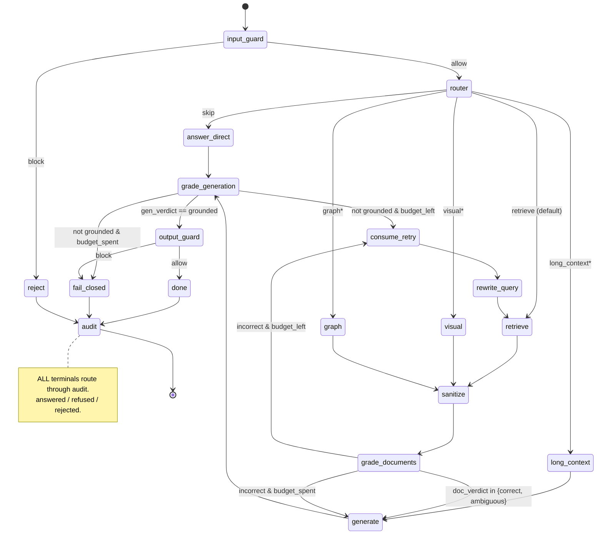

# The agentic verification loop — fail closed, not confidently wrong

> Module map: `src/iw_rag/agent/` (`state.py`, `edges.py`, `budgets.py`, `nodes.py`, `graph.py`, `tools.py`, `prompts.py`) and `src/iw_rag/generation/answer.py`.
> Design: `docs/build/02-lld/lld-agentic-loop.md`, `docs/build/00-architecture/adr/ADR-008-agentic-loop-adaptive-rag.md`, `docs/build/00-architecture/adr/ADR-002-orchestration-langgraph-llamaindex.md`.

## 1. The thesis: the verification layer *is* the product

A bare RAG system retrieves some chunks, stuffs them into a prompt, and emits whatever the model says. It "looks right" most of the time — and is confidently, untraceably wrong the rest of the time. iw-rag's defining feature is not the generator; it is the **self-correcting loop wrapped around it** that grades its own retrieval and its own draft, and — when it cannot ground an answer in the evidence — **refuses** rather than hallucinate.

This is the explicit position in `ADR-008`: *"The system's defining feature is not the answer generator but the verification layer around it."* "Looks right" is not "done." Every loop edge is **conditional on a grade**, the cycle is **hard-bounded**, and on budget exhaustion the graph routes to a dedicated terminal `fail_closed` node that emits an honest refusal. The refusal is a **first-class result**, not an error path — `fail_closed` in `nodes.py` carries the invariant in its docstring:

> "This node never sets `answer` to a non-`None` value and never sets `disposition="answered"`."

The same invariant is restated at the assembler level in `generation/answer.py`: an empty `RetrievalResult` produces an honest refusal **with no LLM call at all** — there is nothing to ground, so the model is never asked.

Three disposition values describe how a turn ends (assembled at the audit node, `nodes.py`):

| Disposition | Meaning | Where it is set |
|---|---|---|
| `answered` | A grounded, cited answer passed every grade and guard. | `done` node (`gen_verdict == "grounded"`). |
| `refused` | The loop could not ground an answer; budget exhausted or the output guard blocked it. | `fail_closed` node. |
| `rejected` | The **input** guard blocked the turn before any retrieval or generation. | `reject` node (mapped to `rejected` in `make_audit_node`). |

Note a subtlety verified in the code: `GraphState["disposition"]` itself is only ever `"answered"` or `"refused"` (see `state.py`). The third value, `rejected`, is derived in `make_audit_node` by detecting a `Verdict(kind="reject")` in the trail and re-mapping a state-level `refused` to the audit-level `rejected`. So *input-guard rejection* and *fail-closed refusal* share the same in-graph disposition but are distinguished in the audit record.

## 2. Graph topology — node by node

LangGraph owns orchestration; the retrieval spine is wrapped as an opaque tool node (see §4). The full compiled graph (when an LLM is wired — `build_graph(spine, assembler, llm, …)` in `graph.py`) is:



`*` = the `visual` / `graph` / `long_context` branches are **Phase-4 modes**. They are only wired when the corresponding retriever/route is injected into `build_graph` (`visual_retriever`, `graph_retriever`, `long_context_route`) **and** the matching `modes.*.enabled` flag is true. Otherwise `route_after_router` (`edges.py`) collapses them to `retrieve`, preserving the intended route in `verdicts` for router-accuracy metrics. The rest of this chapter focuses on the default `retrieve` path.

### 2.1 `input_guard` → router/reject

The entrypoint (`START → input_guard`, `graph.py`). `input_guard_node` runs the Phase-3 input guard and writes `state["input_decision"]`. The pure edge `route_after_input_guard` (`edges.py`) reads it: `"allow"` → `router`; **anything else** (`"block"`, `None`, an unexpected value) → `reject`. The predicate is deliberately conservative — fail-closed on any non-`allow` value. `reject` sets `disposition="refused"` and a canonical "request blocked by input guard" message, then flows to `audit` (where it becomes `rejected`).

### 2.2 `router` — Adaptive-RAG complexity classification

`make_router(llm, settings)` issues a **constrained / structured-output** classifier call (not a full generation). The schema (`prompts.py`) emits a `query_type` (`factual | multihop | wholedoc | relational`) and a `route` (`skip | retrieve | graph | long_context | visual`). It writes `route` + `query_type` to state and appends a `Verdict(kind="route", …)`. Defensive behavior verified in `nodes.py`: an **unknown label defaults to `retrieve`**; `skip` is downgraded to `retrieve` when `settings.skip_enabled` is false; Phase-4 routes are recorded as `intended:<route>` in the verdict reason but collapsed to `retrieve` when their mode is off.

`route_after_router` then dispatches: `skip` → `answer_direct`; `retrieve`/`None` → `retrieve`.

### 2.3 `retrieve` → `sanitize` → `grade_documents`

`retrieve` is a node built by `make_retrieve_node(spine)` (`tools.py`) wrapping the spine callable. It threads `state["access_context"]` into the spine call so the **ACL pre-filter executes inside retrieval** — the loop never constructs an ACL predicate and never derives entitlements from the question or the LLM. The spine returns a `RetrievalResult`, and the node writes `RetrievalResult.chunks` (a `list[RetrievedChunk]`) into `state["chunks"]`.

`sanitize` (`sanitize_node`) sits between retrieve and grading (Phase-3.2). It runs the per-chunk injection scan, PII redaction, and datamark spotlighting over `state["chunks"]`, writing the cleaned list back. Crucially the **corrective cycle re-enters through `sanitize`** too — `rewrite_query → retrieve → sanitize` — so *every* retrieval pass is sanitized, not just the first. (Guardrails are covered in `./06-guardrails.md`; the loop just reserves the seam.)

`grade_documents` (`make_grade_documents`) is the **CRAG / ISREL** node. Each chunk gets a binary relevance grade, batched into one vLLM request set so continuous batching amortizes them. The grades aggregate via the pure `_aggregate_doc_verdict` helper (`nodes.py`, unit-tested) into a 3-action `doc_verdict` — note the **code uses `correct`/`incorrect`/`ambiguous`**, *not* the `relevant/irrelevant` wording the LLD prose uses:

| `doc_verdict` | Condition | Routing |
|---|---|---|
| `correct` | **all** graded chunks relevant | → `generate` |
| `ambiguous` | **some** (≥1) relevant, not all | → `generate` (latency call; ambiguity recorded in `verdicts`) |
| `incorrect` | **none** relevant, or empty list | → `consume_retry` (if budget) else `generate` (which will fail-close downstream) |

The kept relevant subset is written to `state["graded"]`. The grade verdict is appended to `verdicts`.

### 2.4 `generate` — the single grounded-citation generator

`make_generate(assembler)` (`graph.py`) delegates to `AnswerAssembler.generate` in `generation/answer.py`. It reconstructs a `RetrievalResult` from `state["graded"]` (falling back to `chunks` if grading is a stub) with `acl_applied=True` (ACL was already asserted in retrieve), and calls the **citation-required** Qwen3-14B generator. The generator is off-the-shelf — it does **not** self-grade; all reflection is externalized to the grade nodes (`ADR-008`: "the *semantics* as external grader-LLM calls, not the training").

The assembler is where citations become real (§4). Output: `answer` (the draft text), `citations`, `used_chunk_ids`, and a `Verdict(kind="generate", …)`. On the `skip` route, `answer_direct` plays the generate role from parametric memory (no retrieval, empty citations) and also flows into `grade_generation`.

### 2.5 `grade_generation` — Self-RAG, externalized

`make_grade_generation` runs **two graders batched together** (`nodes.py`):

- **ISSUP (groundedness/support):** is the draft supported by `graded` evidence?
- **ISUSE (answer-quality):** does the draft actually answer `original_question`?

A hard deterministic short-circuit fires first: **no/invalid citations → `unsupported`** *before any ISSUP model call* — if nothing resolved, it cannot be grounded. The two grader booleans aggregate via the pure `_aggregate_gen_verdict` helper:

| `(supported, answers)` | `gen_verdict` | Meaning / routing |
|---|---|---|
| `(True, True)` | `grounded` | both pass → `output_guard` → `done` |
| `(False, *)` | `unsupported` | recycle to retrieval (wants better *evidence*) |
| `(True, False)` | `not_answering` | recycle (wants a better *query*) |

`route_after_grade_generation` (`edges.py`): `grounded` → `output_guard`; `unsupported`/`not_answering`/`None` with `budget_left` → `consume_retry`; otherwise → `fail_closed`.

### 2.6 `output_guard` → `done` / `fail_closed`

The grounded path does **not** go straight to `done`. It first passes `output_guard_node`, which performs deterministic citation validation + PII redaction and **reads `state["gen_verdict"]` for groundedness — the ONE groundedness authority, no second model call** (`graph.py` comment; `lld-frontend`/`lld-guardrails` agree). `route_after_output_guard`: `"allow"` → `done`; anything else → `fail_closed`. Citation failure is a **hard block** that cannot be overridden by the groundedness check.

`done` (`nodes.py`) is the only node that promotes `draft → answer` and sets `disposition="answered"` — and it does so *only* when `gen_verdict == "grounded"`, enforcing the no-answer-without-a-grade invariant. (HITL `interrupt_before=["done"]` pauses here when enabled; off by default.)

### 2.7 `audit` — every terminal routes through it

This is a load-bearing topology fact: **`done`, `fail_closed`, and `reject` all route to `audit`, and only `audit` routes to `END`** (`graph.py`). `make_audit_node` assembles an `AuditRecord` (disposition + verdict trail + chunk IDs + ACL applied) and persists it. If the audit write **fails, the node fails closed** — it clears the answer and sets `disposition="refused"`, because an unauditable answer is never emitted. (When no DB session factory is wired — unit tests — `audit` is a no-op pass-through, decision D11.)

## 3. Adaptive-RAG: route, grade, bound, fail closed

The loop fuses three published patterns (`ADR-008`):

1. **Router (Adaptive-RAG).** Decide *whether* to retrieve. ~8% of queries (greetings, definitions, arithmetic) take the `skip` route and never touch the corpus — the single cheapest latency win. Everything else defaults to `retrieve`.
2. **CRAG grading loop.** Grade retrieved docs (`grade_documents`); on weak support, **rewrite the query and re-retrieve**. CRAG's web-search fallback is out of scope (local-only), so query-rewrite + re-retrieve is the substitute.
3. **Self-RAG verification (externalized).** Grade the *generation* for groundedness and usefulness (`grade_generation`); recycle or accept.

### The bounded retry / rewrite-and-re-retrieve cycle

The correction cycle is `… → consume_retry → rewrite_query → retrieve → sanitize → grade_documents → …`. Both failure surfaces feed it: a `doc_verdict == "incorrect"` and a non-grounded `gen_verdict` both route to `consume_retry`. `rewrite_query` (`make_rewrite_query`) reformulates from `original_question` plus the failure signal it reads from `doc_verdict`/`gen_verdict`, so successive rewrites do not drift off the user's intent.

### The budget that bounds it

Two complementary brakes compose (`budgets.py`, `ADR-008`):

1. **State counter (primary).** `budget_left(state)` is the pure predicate `retries < max_retries`. `retries` is incremented in **exactly one place** — the `consume_retry` node — so the document-grade and generation-grade recycle paths **share one budget**. A query cannot get `2 × max_retries` passes by alternating failure types. `DEFAULT_MAX_RETRIES = 2` (demo: 1–2 passes, R-00105 F5).
2. **`recursion_limit = 25` (safety net).** LangGraph's super-step cap. If any cycle ever escapes the counter, LangGraph raises `GraphRecursionError`. `answer_question` (`graph.py`) **catches it and converts it to a fail-closed refusal** — never a 500 to the caller — and logs it as an anomaly (the counter *should* have tripped first).

Budget-boundary semantics are explicitly documented and unit-tested in `edges.py`: `retries == max_retries - 1` → `budget_left` true → recycle; `retries == max_retries` (or greater) → false → terminal (`generate`/`fail_closed`). These edge predicates are pure and synchronous — the loop's correctness *is* its edge logic, which is why they are the highest-value unit tests.

## 4. Why LangGraph, and why one grounded-citation generator

**LangGraph for orchestration (`ADR-002`).** The showcase's deliverable is *cycles* (grade → rewrite → re-retrieve), durable checkpointed state, and human-in-the-loop — not a DAG. LangChain/DAG frameworks have no native cycles ("fundamental for true agentic behavior like self-correction"). LlamaIndex Workflows could orchestrate too but the core competency here is exactly LangGraph's: native cycles, durable checkpointing/time-travel, and `interrupt()`. So responsibilities split along the 2026-converged boundary: **LangGraph orchestrates; LlamaIndex retrieves and is exposed to the graph as a single tool node** returning a `RetrievalResult`. LangGraph is the heaviest framework on raw overhead (~14 ms/2k tokens) — acceptable, since loop latency is dominated by LLM calls, not framework overhead.

**One grounded-citation generator.** There is a single answer path: `AnswerAssembler.generate` (`generation/answer.py`). It enforces that **every `[n]` marker in the answer resolves to a real source**:

- `parse_citation_markers` extracts `[1]`, `[1,2]`, `[1][2]` tolerantly.
- `_resolve(markers, chunks)` maps each marker to a `Citation(marker, chunk_id, source_uri, quote)` — **out-of-range markers are dropped** and recorded in `diagnostics["dropped_markers"]`. A hallucinated `[7]` over five chunks simply does not become a citation.
- `quote` is the precise matched **leaf** span (`chunk.leaf_content or chunk.content`) — small-to-big: the citation points at the exact sentence even when the model saw a parent-expanded window — with datamark spotlighting tokens stripped (`strip_datamarks`) so the invisible guard markers never reach the user.
- Reasoning-model scratchpads (`<think>…</think>`) are stripped before parsing/emit (`strip_reasoning`), so chain-of-thought never reaches the user *or* the citation parser.
- `cite_required=True` (default): an answer with **no resolved citation is treated as ungrounded** (`grounded=False`). Combined with `grade_generation`'s "no citations → `unsupported`" short-circuit, an uncited draft can never become an `answered` turn.

This is *structural* validation: every marker resolves to a real source. **Deep** groundedness — does the cited source actually *support* the claim — is the Phase-3 output guard's ISSUP job (`./06-guardrails.md`). The two are kept as one authority: the output guard reads the same `gen_verdict` the loop already computed.

## 5. Streaming (SSE) vs JSON, and one Phoenix trace

The loop has two public entrypoints in `graph.py`:

- `answer_question(graph, question, ctx, …) -> GraphState` — single-turn invoke; returns the terminal state (answer or refusal). Used by the JSON `/query` path.
- `answer_question_stream(graph, question, ctx, …) -> AsyncIterator[dict]` — streams SSE-shaped event dicts as nodes complete.

### The Q-SSE event taxonomy (canonical — one set, three layers agree)

The SSE schema is **resolved** (OPEN-QUESTIONS `Q-SSE-SCHEMA`). The canonical set is:

```
token · step · source · verdict · final · refusal · error      (+ ": ping" heartbeats)
```

`answer_question_stream` consumes `graph.astream(...)` in `stream_mode="updates"` (per-node deltas) and emits the subset it can produce; the API's `_sse_generator` formats those frames and appends `error` on any mid-stream failure:

| Event | Emitted by | When | Key `data` fields |
|---|---|---|---|
| `: ping` | route | stream opens | — (SSE comment heartbeat) |
| `token` | — | *reserved; not yet emitted* | `text` (incremental answer) |
| `step` | loop | every node completes | `node`, `status`, `attempt`, `detail` |
| `source` | loop | once per retrieved chunk | `chunk_id`, `document_id`, `source_uri`, `score`, `snippet` |
| `verdict` | loop | once per `Verdict` appended | `kind`, `value`, `score`, `reason` |
| `final` | loop | terminal `disposition == "answered"` | `answer`, `citations[]`, `trace_ref`, `acl_applied`, `attempts` |
| `refusal` | loop | any non-answered terminal | `reason_code` (`no_grounded_answer`), `message`, `trace_ref` |
| `error` | route | any mid-stream failure | `message` (generic — never exception text/PII), `trace_ref` |

A subtlety the code handles: because `astream` yields *deltas*, the terminal `done` delta carries `disposition` but **not** `citations` (which were emitted earlier by `generate`). The stream therefore **merges deltas** into `final_state` so the `final` event carries the full citation set — mirroring the reducer the non-streaming `ainvoke` path applies.

> **Reconciliation note.** An earlier draft of the frontend LLD listed `citation`/`trace` frame names; those pre-dated the Q-SSE-SCHEMA resolution and have been corrected to `source`/`verdict`/`refusal`. All three layers now agree: the canonical set above is decoded by the frontend client (`ApiEvent.type`), emitted by `answer_question_stream` + `_sse_generator`, and asserted by `tests/unit/test_frontend_sse.py` + `tests/unit/agent/test_query_stream.py`. `token` (incremental text) remains reserved-but-unemitted — a consumer must treat `final.answer` as the whole answer and tolerate the absence of `token`.

### One trace per request

Both entrypoints open a single root span — `iw_rag.query` (`observability.tracing.span`) — tagged with `thread_id` and a **hash** of `AccessContext.principal_groups` (never the raw groups). OTel contextvars propagate into the awaited nodes, so every per-node span (`iw_rag.agent.route`, `…done`, the graders, the guards) **nests under one Phoenix trace** rather than scattering as separate single-span traces. The terminal `final`/`refusal` event carries a `trace_ref` so the UI can deep-link to that exact trace. Trust and evaluation build on this — see `./08-trust-and-eval.md`.

## 6. Worked examples — the verdict trail

### 6.1 A grounded answer

Question: *"How many vacation days do new employees get?"* — principal in the `hr` group.

```
step    {node: input_guard,  status: complete}        # allow
verdict {kind: route, value: retrieve, reason: "factual"}
step    {node: retrieve,     status: complete}        # ACL pre-filter inside spine
source  {chunk_id: hr_leave#3, source_uri: hr/leave_policy.md, score: 0.81, snippet: "New employees accrue 20 days..."}
source  {chunk_id: hr_leave#4, source_uri: hr/leave_policy.md, score: 0.74, snippet: "Accrual begins on the start date..."}
step    {node: sanitize,     status: complete}
verdict {kind: grade_documents, value: correct, score: 1.0}     # both chunks relevant → generate
step    {node: generate,     status: complete}
verdict {kind: generate, value: answered, score: 1.0}
verdict {kind: grade_generation, value: grounded}              # ISSUP=supported, ISUSE=answers
step    {node: output_guard, status: complete}                # allow (citations valid, no PII)
step    {node: done,         status: complete}
step    {node: audit,        status: complete}                # disposition=answered
final   {answer: "New employees accrue 20 vacation days per year, beginning on their start date [1][2].",
         citations: [{marker:1, chunk_id: hr_leave#3, source_uri: hr/leave_policy.md, quote: "New employees accrue 20 days..."},
                     {marker:2, chunk_id: hr_leave#4, source_uri: hr/leave_policy.md, quote: "Accrual begins on the start date..."}],
         trace_ref: "…", acl_applied: true, attempts: 8}
```

Every `[n]` resolves to a real source; the answer passed `grade_documents` → `grade_generation` → `output_guard` before `done` promoted the draft.

### 6.2 A fail-closed refusal

Question: *"What is our policy on cryptocurrency payroll?"* — corpus has nothing on it. `max_retries = 1`.

```
step    {node: input_guard,  status: complete}        # allow
verdict {kind: route, value: retrieve, reason: "factual"}
step    {node: retrieve,     status: complete}
source  {chunk_id: hr_leave#3, source_uri: hr/leave_policy.md, score: 0.21, snippet: "...vacation accrual..."}
step    {node: sanitize,     status: complete}
verdict {kind: grade_documents, value: incorrect, score: 0.0}  # none relevant → budget_left → consume_retry
step    {node: consume_retry, status: complete}               # retries: 0 → 1
step    {node: rewrite_query, status: complete}               # reformulated from original_question
step    {node: retrieve,     status: complete}                # re-retrieve through sanitize again
verdict {kind: grade_documents, value: incorrect, score: 0.0}  # still none relevant; retries == max_retries → no budget
step    {node: generate,     status: complete}               # generates over empty graded set
verdict {kind: grade_generation, value: unsupported}          # no citations → unsupported (deterministic)
                                                              # budget spent → fail_closed
step    {node: fail_closed,  status: complete}
verdict {kind: fail_closed, value: refused, reason: "budget_exhausted retries=1; last_doc_verdict='incorrect'; last_gen_verdict='unsupported'"}
step    {node: audit,        status: complete}                # disposition=refused
refusal {reason_code: "no_grounded_answer", message: "I can't ground an answer in the retrieved evidence.", trace_ref: "…"}
```

The verdict trail is the receipt: route chosen, two `incorrect` document grades across the bounded retry, an `unsupported` generation grade, and the terminal `fail_closed`. No ungrounded answer was ever emitted — the system made its signature **judgment about when *not* to trust the LLM**, and the whole decision is auditable in one Phoenix trace.

---

## Related

- [`./04-retrieval-spine.md`](./04-retrieval-spine.md) — the spine wrapped as the `retrieve` tool node; ACL pre-filter, hybrid + RRF + rerank, the `RetrievalResult.chunks: list[RetrievedChunk]` contract this loop grades.
- [`./06-guardrails.md`](./06-guardrails.md) — `input_guard` / `sanitize` / `output_guard` / `audit` nodes that attach to this graph and share the ISSUP/fail-closed seam.
- [`./08-trust-and-eval.md`](./08-trust-and-eval.md) — the `iw_rag.query` Phoenix trace, the verdict trail as evidence, and the loop-on-vs-off faithfulness/latency benchmarks.
