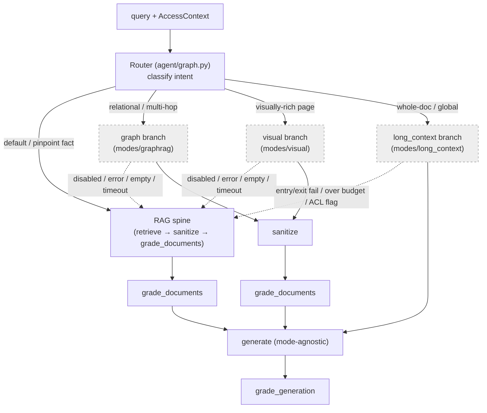
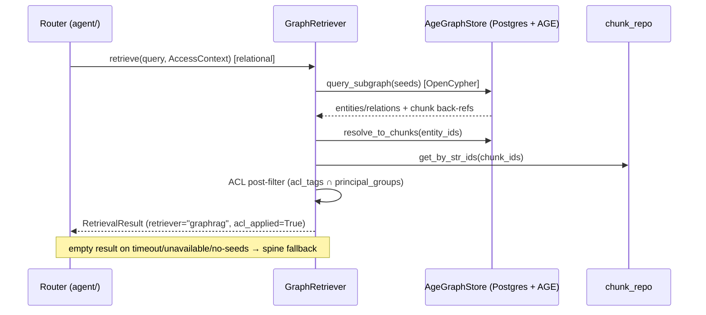
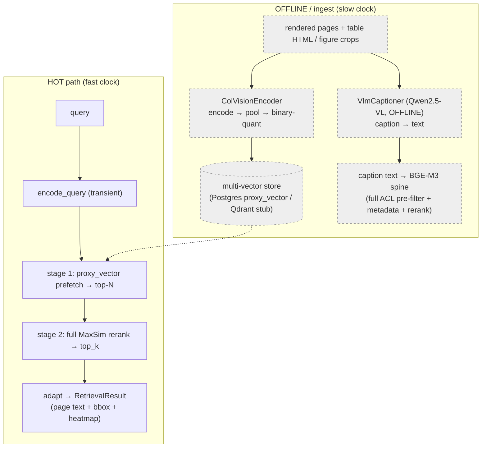
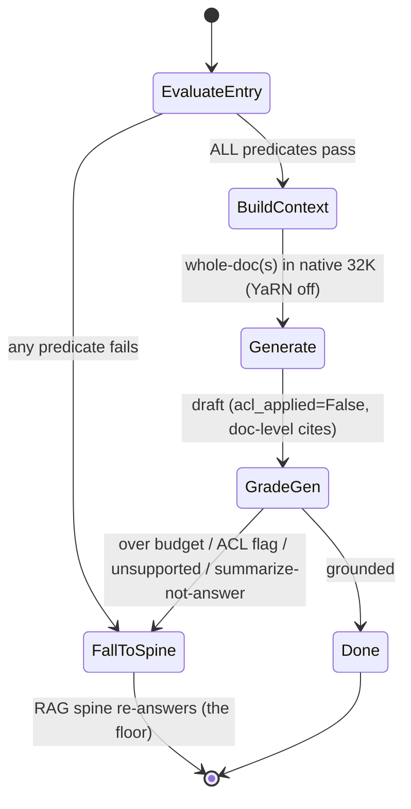

# Optional retrieval modes — GraphRAG, visual, long-context

The spine (hybrid dense + sparse → RRF fusion → rerank, ACL pre-filtered) answers
the overwhelming majority of queries. It is the floor everything else falls back to.
On top of it iw-rag ships **three optional, router-gated modes** for the query
shapes the spine handles less well:

| Mode | Module | Wins on | Status of live numbers |
|---|---|---|---|
| **GraphRAG** | `src/iw_rag/modes/graphrag/` | multi-hop / relational / "connect the entities" | ✅ **run live** (AGE on PG18) → measured negative, route off |
| **Visual** | `src/iw_rag/modes/visual/` | visually-rich docs (tables, figures, layout) | ✅ **run live** (both arms) → 1.000 tie; text ≈0 |
| **Long-context** | `src/iw_rag/modes/long_context/` | whole-document / global reasoning over a small corpus | ✅ **run live** (native 32K) → needle win |

All three are **off by default** and **gated on their experiment**. As of 2026-06-08
every one has been **run live** (demo-scale) — see [ch08 §3](./08-trust-and-eval.md)
and `eval/reports/{graphrag,visual,longcontext}_experiment.md`. This chapter explains
the unifying contract, each mode's design, and the measured result. Each remains
*measured before it is trusted*.

> **Honest framing up front.** The headline experiments (#6 / #7 / #8) have now been
> executed live at demo scale. Their *results* (below and in ch08) decide each mode's
> fate: GraphRAG's graph arm did **not** beat the spine → it **stays off by config**
> (a valid measured outcome); visual and long-context show real wins on their target
> query shapes but stay **gated** (off by default, enabled only for the query types
> they earn). Building these live also required real work the code had left as
> stubs/fakes (the AGE store bugs, the ColVision encode client) — documented per mode
> below. Larger-corpus / full-sweep runs remain the next deferral.

---

## 1. The unifying principle: one contract, four branches, one floor

Every mode is the **same shape** to the rest of the system. The agent router
(`src/iw_rag/agent/graph.py`, `src/iw_rag/agent/edges.py`) is a conditional edge with
four possible retrieval destinations, three of which are optional:

1. It is a **gated 4th (or 5th) router branch.** The branch only exists in the
   compiled graph when its retriever/route object is *injected* into `build_graph(...)`
   **and** its `modes.*.enabled` flag is true. Otherwise the route **collapses to the
   spine** (`"retrieve"`).
2. It returns the **same `RetrievalResult.chunks: list[RetrievedChunk]` contract** as
   the spine (the canonical type, defined once in `src/iw_rag/domain/models.py`;
   never `Candidate`, `.candidates`, or `passages`).
3. It **falls back to the spine** on any error, timeout, or empty result. A mode is an
   optimisation; the spine is the floor. A mode never *blocks* an answer.
4. The **generator, guardrails, and eval stay mode-agnostic.** They consume a
   `RetrievalResult` and cannot tell which retriever produced it.
5. Each must be **MEASURED before it is trusted** — gated behind a headline experiment
   (#6 / #7 / #8) that proves the win *and* the no-loss before the mode is enabled.

### The collapse-to-spine mechanism

`route_after_router` in `src/iw_rag/agent/edges.py` is the single point that enforces
the "off by default" guarantee. It returns the intended route label only when the mode
is both wired and enabled; otherwise it returns `"retrieve"`:

- `"visual"` → `"visual"` when `modes.visual.enabled=True` **and** a `visual_retriever`
  was injected; otherwise `"retrieve"`.
- `"graph"` → `"graph"` when `modes.graphrag.enabled=True` **and** a `graph_retriever`
  was injected; otherwise `"retrieve"`.
- `"long_context"` → `"long_context"` when `modes.long_context.enabled=True` **and** a
  `long_context_route` was injected; otherwise `"retrieve"`.

`build_graph(...)` only calls `g.add_node(...)` for a mode when its dependency is
non-`None` (see `src/iw_rag/agent/graph.py` ≈ lines 583–625). With the defaults — every
mode object `None`, every `modes.*.enabled=false` — the graph is exactly the spine
topology, and the optional branches are dead labels that immediately collapse.

### Router dispatch and fallback



Note the two **topology differences** in that diagram, both verified in
`src/iw_rag/agent/graph.py`:

- **graph and visual are *retrievers*.** Their nodes flow into `sanitize` →
  `grade_documents` exactly like the spine's `retrieve` node. They produce chunks; those
  chunks get sanitized and graded.
- **long-context is *not* a retriever.** Its node bypasses `sanitize` and
  `grade_documents` and flows **directly to `generate`** — see §4.

---

## 2. GraphRAG mode — `modes/graphrag/`

**What it is for.** Multi-hop, relational, cross-document, entity-aggregation, and
global-summary queries — the "connect entity A to entity C through B" questions where a
plain vector lookup retrieves disconnected passages. The design rationale is in
[ADR-009](../docs/build/00-architecture/adr/ADR-009-graphrag-optional-lightrag.md) and
the LLD in [lld-graphrag.md](../docs/build/02-lld/lld-graphrag.md).

GraphRAG ties or *loses* to the spine on simple/factual/procedural queries while adding
100×–376× token overhead and hours of LLM-bound indexing. That is exactly why it is
never the baseline — only a gated route.

### Two clocks: offline extraction vs. hot-path query

`modes/graphrag/` owns two halves split across the **two clocks**:

- **Slow clock — `GraphIndexer` (`indexer.py`), offline only.** Extracts entities +
  typed relations from chunks already in Postgres, using a **small dedicated extraction
  model (Qwen3-4B), not the Qwen3-14B generator**, and set-merges the graph into Apache
  AGE. Incremental (dedup on `source_uri` + `checksum`); community summaries skipped by
  default (the dominant cost driver).
- **Fast clock — `GraphRetriever` (`retriever.py`), hot path.** On a relational query it
  runs an AGE OpenCypher subgraph traversal, resolves entities back to source
  `chunks.id`, ACL-filters, and adapts to a `RetrievalResult`.

**The two-clocks guard is real and enforced operationally.** Graph indexing runs *only*
through `scripts/index_graph.py`, whose module docstring is explicit: "OFFLINE / batch
only … the **only** way graph indexing runs … never triggered by a `/query`" (verified
in the script). The hot-path retriever issues **only AGE *read* queries** — it does not
invoke LightRAG's query engine, because that would require a running extraction-model
endpoint on the hot path. From `retriever.py`:

> "LightRAG's query engine is heavy and requires a running LLM endpoint … On the hot
> path, only AGE read queries are acceptable."

So the indexer can never queue extraction calls against the resident generator.

### Hot-path flow



The retriever sets `retriever="graphrag"` and `acl_applied=True` on its result, and
degrades — never blocks — on every error (`GraphRouteTimeout`, `GraphStoreUnavailable`,
empty subgraph, ACL drops everything) by returning an empty `RetrievalResult` so the
router falls back to the spine.

### Honest status

- **Run live on AGE-for-PG18 (2026-06-08).** The default ParadeDB image (Postgres 18)
  lacks the `age` extension; Apache AGE only ships a PG18 *release candidate*. It was
  **built from source into an isolated ParadeDB copy** (the live store untouched), the
  corpus restored, and the graph indexed (147 vertices / 289 edges). The first real run
  also exposed and fixed **three never-live-tested store bugs** (literal `cypher()` graph
  name; `create_graph` transaction-abort; relation-type identifier sanitization — see
  commit `28f8845`). Result: the graph arm scored **0.000 vs the spine → the route stays
  off by config** (`eval/reports/graphrag_experiment.md`).
- **Seed extraction is a simple keyword tokenization on the query string** (no model call
  on the hot path) — and this is exactly *why* the graph arm lost: query tokens like
  `audit`/`logs` never exact-match multi-word entity names like `Ada Lovelace`, so the
  subgraph comes back empty. Full LightRAG `mix` semantics (model-based entity linking,
  WI-031) would be needed to make the arm competitive and remain a deferral — the
  two-clocks rule keeps that NER model off the hot path.
- **ACL-on-graph-traversal is an open item.** The spine enforces ACL as a strict
  **pre-filter** (`WHERE acl_tags && :principal_groups` *before* retrieval). A graph
  traversal cannot naturally pre-filter — entities span documents with different ACLs — so
  the graph route **post-filters** resolved chunks. That is a genuine tension with the
  spine invariant (a relation can encode that two entities are connected even if one source
  chunk is then dropped). Until graph nodes/edges carry their own `acl_tags` so traversal
  itself is ACL-scoped, the conservative rule holds: **the graph route is restricted to
  uniformly-readable corpora.**

**Headline experiment #6** is the gate: graph route vs. hybrid spine on a multi-hop
golden set (expect a recall/faithfulness *win*) **and** a procedural set (expect *no loss*
via the `mix`/degrade behaviour). The mode is enabled only if #6 passes. **#6 has now been
run live at demo scale (2026-06-08) on AGE-for-PG18** — and on this tiny corpus the graph arm
did *not* clear the bar (see above: exact-match entity lookup without a hot-path NER model), so
the mode **stays off by default** pending a larger-corpus rerun with full `mix` entity-linking.

---

## 3. Visual mode — `modes/visual/`

**What it is for.** Visually-rich documents — tables, figures, charts, scanned layout —
where vision-native late interaction (ColPali / ColQwen-style) decisively beats
OCR+caption. Rationale in
[ADR-010](../docs/build/00-architecture/adr/ADR-010-multimodal-visual-colqwen.md); LLD in
[lld-multimodal.md](../docs/build/02-lld/lld-multimodal.md).

### Retrieval-only, two clocks

The hard VRAM decision: **no VLM is resident at query time.** The encoder finds the
*page*; the resident Qwen3-14B text generator answers from the **extracted text of that
page** — so there is no co-residence with the generator on the single 32 GB card.

- **Hot path (allowed):** `ColVisionEncoder` (`encoder.py`) encodes the *query* into a
  multi-vector, then `VisualRetriever` (`retriever.py`) runs a two-stage retrieval:
  stage-1 pooled/binary prefetch → stage-2 full-resolution MaxSim rerank → `top_k`,
  ACL-post-filtered. The encoder is transient on GPU, never co-resident.
- **Slow clock (offline only):** `VisualIndexer` (`indexer.py`) encodes rendered pages →
  pools → binary-quantizes → upserts. `VlmCaptioner` (`captioner.py`, Qwen2.5-VL) captions
  table HTML / figure crops into **text** and embeds it through the BGE-M3 spine, then
  unloads. Both run only via `scripts/index_visual.py`, whose docstring asserts it "MUST
  NOT be imported by or called from any hot-path module."

### The proxy vector and the Postgres-vs-Qdrant fork

Multi-vector MaxSim has **no native Postgres index**. The default backend
(`PostgresCandidateStore`) is therefore *rerank-over-candidates*: stage-1 candidates come
from a mean-pooled single-vector **`proxy_vector`** (a `vector(128)` — the encoder's
`dims` default is `128`, verified in `encoder.py`) searched via pgvector HNSW, then stage-2
MaxSim is computed in-process over the candidate set's stored pooled multi-vectors. This
keeps the single-store, single-backup story.

`QdrantMultiVectorStore` is the **scoped trigger** — the *only* sanctioned reason to add a
second store, fired only if the visual demo is promoted to headline. In the current tree it
is an explicit **SEAM/STUB**: its methods `raise NotImplementedError("QdrantMultiVectorStore
is a stub/seam — see ADR-007")` (verified in `store.py`). It is wiring, not a live backend.



### Honest status

- **Real ColVision encoding was built and run live (2026-06-08).** The encoder client is
  *injected* (only a fake existed in tests), so a real one was written around
  `vidore/colqwen2.5-v0.2` (colpali late-interaction, MaxSim). It needed a specific
  isolated environment — colpali-engine 0.3.10 + transformers 4.51.3 + `torch 2.11.0+cu130`
  (Blackwell) — because the published adapter's LoRA keys break on the project's newer
  transformers and a default torch has no RTX 5090 kernels. It now ranks the correct page
  #1 for every query.
- **A real visual golden set was built.** A 10-page synthetic corpus (PIL-rendered
  charts/tables, facts visible only in the image) + a 4-query golden
  (`eval/golden/visual_golden.yaml`). On it, **both** the ColVision arm and the
  parse-then-caption arm score **1.000** (text spine ≈0 by construction) — a tie; the
  ColVision-vs-caption separation needs a denser/blurrier corpus
  (`eval/reports/visual_experiment.md`).
- **The caption fallback is the ACL-safe default.** Parse-then-caption embeds captions as
  text into the BGE-M3 spine, which **inherits the spine's ACL pre-filter natively**. The
  page-image MaxSim path, like graph traversal, can only ACL **post-filter** today — so
  until `acl_tags` live alongside the multi-vectors for a stage-1 pre-filter, the visual
  page-image route is restricted to uniformly-readable corpora, and the caption fallback is
  the default for ACL-scoped content.

**Headline experiment #7** is the gate: ColQwen2.5 vs. parse-then-caption + BGE-M3 on a
visually-rich set — **run live**, both arms 1.000 (text ≈0). The remaining pieces — the
compressed-index-size comparison and the pooling/quantization quality-cliff sweep — need
a larger/denser visual corpus and are **not yet run**.

---

## 4. Long-context mode — `modes/long_context/`

**What it is for.** Whole-document / global reasoning over a *small, bounded* corpus —
"summarize this contract", "compare clauses across this document" — where stuffing the
document(s) into the native window beats chunked retrieval. Rationale in
[ADR-012](../docs/build/00-architecture/adr/ADR-012-long-context-vs-rag.md); LLD in
[lld-long-context.md](../docs/build/02-lld/lld-long-context.md).

This is the one mode that is **not a retriever**: it bypasses search entirely and stuffs
whole documents into Qwen3-14B's **native 32K window (YaRN off)**. It still satisfies the
contract by emitting a `RetrievalResult` whose `chunks` are the stuffed document(s) with
**document-level citations**.

### The gated 4th branch and its distinct wiring

The long-context node (`make_long_context_node` in `agent/nodes.py`, wired in `graph.py`)
is wired with the key topology difference, captured verbatim in the `build_graph` source
as decision **D23**:

```
long_context: long_context_retrieve → generate → grade_generation → ...
              (BYPASSES sanitize AND grade_documents)
```

The wiring is `g.add_edge("long_context", "generate")` — it does **not** go through
`sanitize` or `grade_documents`. The code comments give the three reasons:

1. **Nothing was retrieved from a chunk index.** The whole doc is assembled; per-chunk
   relevance grading (`grade_documents`) is meaningless.
2. **`acl_applied=False` is *correct* here**, and `sanitize` asserts `acl_applied=True` on
   chunks. Running `sanitize` would trip that assertion. Long-context is the **single
   sanctioned `acl_applied=False`** in the whole system (CONVENTIONS §6): its entry
   predicate admits **only** non-ACL, attribution-free, static whole-doc queries — so there
   is nothing to pre-filter. The spine, graph, and visual hot paths all keep
   `acl_applied=True`.
3. The node writes **both** `state["chunks"]` and `state["graded"]` directly (the assembled
   doc-level chunks), so `generate` consumes `state["graded"]` without a grading step.

### Entry predicate and exit/fallback

`LongContextRoute.evaluate_entry` (`route.py`) is a **hard predicate — all must pass**:

1. intent is whole-document / global (label from the router),
2. `estimated_input_tokens ≤ lc_max_input` (default 24 000; hard ceiling 30 000),
3. no per-result ACL required,
4. attribution requirement ≤ document-level.

Any failure → `eligible=False` → the router falls through to the spine (or graph for
multi-hop). After generation, `should_fallback(...)` demotes to RAG and re-answers on budget
overrun, an ACL/attribution flag, or a grounding failure (unsupported claim, refusal, or the
"summarize-instead-of-answer" failure mode). **Invariant:** `enable_yarn` is never true for
this route — static YaRN would degrade all the short RAG traffic, so the 131K window is a
separate deliberate config, never this branch.



### Honest status

- **Real 32K prefill was run live (2026-06-08).** The generator was restarted at native
  `--max-model-len 32768` (FP8 KV, prefix caching; `--enforce-eager` +
  `--max-num-batched-tokens 2048` to survive the long-prompt activation spike on 32 GB).
  A ~21K-token document was prefilled per query and the whole-doc arm compared to RAG
  top-k on a buried-needle probe — **long-context recovered the needle that RAG missed**
  even though RAG retrieved the needle chunk (`eval/reports/longcontext_experiment.md`).
- **`lc_max_input` is still a conservative proxy.** 24 000 default / 30 000 ceiling bound
  the probe doc; the full **NoLiMa/RULER depth × length effective-length sweep** that would
  tune them empirically (and the prefix-cache TTFT amortisation curve) remains the next
  deferral — the single-needle probe is indicative, not a benchmark.

**Headline experiment #8** is the gate: whole-doc QA vs. RAG — measured live as a needle
win, honestly caveated (≈21K-token prefill/query → ~6× concurrency ceiling at 32K), so the
route stays gated to whole-doc / global queries.

---

## 5. Why optional, why measured-before-trusted

Each mode buys a capability the spine lacks but pays a real cost: GraphRAG pays hours of
offline extraction and loses on simple queries; visual pays a multi-vector storage blow-up
and (today) weaker ACL on the page-image path; long-context monopolises prefill cycles and
gives up per-claim attribution and per-result ACL. Making any of them always-on would tax the
common case the spine already serves well.

So the system treats "this mode helps" as a **claim to be measured, not asserted**:

| Mode | Gate experiment | Win it must prove | No-loss it must prove |
|---|---|---|---|
| GraphRAG | **#6** | recall/faithfulness on multi-hop | no regression on procedural/policy |
| Visual | **#7** | nDCG@5 / recall on visually-rich docs | acceptable compressed index size |
| Long-context | **#8** | accuracy on whole-doc QA | within VRAM/latency/concurrency budget |

Until its experiment passes, the mode's config `enabled` flag stays `false` and its branch
collapses to the spine. The structural guarantees that hold *regardless* of any experiment:

- the spine is always the floor (every mode falls back to it);
- the generator, guardrails, and eval never change — they consume the one
  `RetrievalResult.chunks: list[RetrievedChunk]` contract;
- ACL is enforced as a pre-filter everywhere except the one sanctioned long-context
  carve-out, and the two modes that can only post-filter today are corpus-restricted until
  that gap is closed.

---

## Related

- [Retrieval spine](./04-retrieval-spine.md) — the floor all three modes fall back to, and
  the source of the `RetrievalResult` contract.
- [Architecture](./02-architecture.md) — where the router, the two clocks, and the trust
  layer sit in the whole system.
